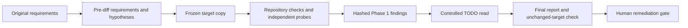

# Gate B closure audit — FAIL

**Observed:** 25 of the 32 listed defects meet their scoped closure checks. Seven remain PARTIAL. Two additional defects remain OPEN. The complete closure matrix is below.

**Gate decision:** Keep Gate B closed to progression. The old review can authorize changed staged content. A dispatch can return `START_WORKER` after a committed route revocation. A durability model can lose an acknowledged host record. These results prevent a clean closure assessment.

**Isolation: partial.** This was a fresh audit context with no implementer conversation. The first authorized source read exposed historical Gate A verdict fields. The current Gate B claims stayed withheld until Phase 1 was written and hashed. This report does not claim full blinding.

## Scope and freeze

- Dispatch: `hma-gate-b-closure-blind-20261016`. Modes: code and outcome.
- Target: `/home/yeli/repos/HMA`, branch `main`, HEAD `67965541b7032a585a68e48f3d10f4a998d5399e`, plus the starting working tree. `.serena/` is excluded.
- Tracked binary diff SHA-256: `1eee27ed75133e778a8b050bad20bff7d6ed2dd4c891e71584186f89ff75847f`.
- All 20 untracked files have individual SHA-256 digests in [FREEZE-start.json](FREEZE-start.json).
- [FREEZE-end.json](FREEZE-end.json) matches the starting HEAD, branch, filtered status, diff digest, and every untracked digest. The audit made no repository edits or Git writes.
- Criteria SHA-256: `ae5945effa0d4aa7aa1d49f043d8fbbed81e52b3daf5218235ef92baf3c8fa9f`.
- [REQUIREMENTS.json](REQUIREMENTS.json) was written before diff inspection. It preserves the requirement sources, all supplied B closure entries, and independent failure hypotheses.
- [PHASE1.json](PHASE1.json) SHA-256: `217b7859ad7b55926c22792be029a303855cf7b6c6f2e84374beabf282fbc1ad`. It remains unchanged. The final report adds the end freeze and a controlled-unblinding addendum.

The authoritative objective is Gate B in `docs/handoffs/2026-10-15-outcome-consolidation-opus-liz.md` §5. The normative sources are `AGENTS.md`, `docs/architecture.md`, and Tasks 13/14. The earlier audit and supplied closure files define the named defect checks. The trusted-host threat model applies. A malicious same-UID actor is outside scope.

Worker declaration: Liz / OpenAI / `gpt-6.1-sol` / high effort. Model and effort are dispatch declarations, not independent runtime attestations. Access was the current host session. No delegated worker, model API, or nested agent CLI ran. Repository access was read-only. Test and output writes stayed below this output directory. No Jev tool was exposed; the documented fallback was used.

## Verification

| Check | Observed result | Raw evidence |
|---|---|---|
| `go version` | Go 1.27.1, linux/amd64; repository go.mod declares 1.21 | [versions.log](versions.log) |
| `go test -count=1 -json ./...` | Exit 0; 12 packages pass; 710 test/subtest pass events; two skips | [test.log](test.log) |
| `go vet ./...` | Exit 0 | [vet.log](vet.log) |
| `go test -race -count=1 -json ./...` | Exit 0; same package/event counts and skips | [race.log](race.log) |
| `bash scripts/dogfood/host-dogfood.sh --keep` | Exit 0; 17 synthetic checks | [dogfood.log](dogfood.log) |
| `gofmt -l cmd internal scripts`; `git diff --check` | No formatting output; diff check exit 0 | [gofmt.log](gofmt.log) |
| Independent combined probes | Exit 1; 137 pass events and 11 fail events, including parent failures; nine failing leaf cases | [probes-final.jsonl](probes-final.jsonl) |
| 24 real concurrent conflicting decision CLIs | Exactly one success and one host record | [process evidence](probes-process-concurrency.json) |
| Refined mode/EOL/legacy-alias full review controls | Exit 0; ten subcases plus parent pass | [control log](probes-refined-controls.log) |
| Concurrent route revocation | Exit 1; CLI returns START_WORKER despite revoked authority | [revocation log](probes-route-revocation.log) |

The tests ran in `repo/`, a copy of the target code. `GOCACHE` and `TMPDIR` are under this output directory. The audit added probe tests only in that copy. The host-store overlay adds event tracing and fault injection. It does not implement a fix. [checks.jsonl](checks.jsonl) records command vectors, exits, and elapsed times. [reproduce.sh](reproduce.sh) provides baseline and probe commands.

The implementation suite skips `TestGateBR2HostChild` as a top-level helper; its parent executes child processes. It also skips `TestGateBR2HostPowerLossImage`. That skip is not evidence of power-loss correctness. The independent durability model passes 32 normal first/successor checkpoints, then fails an existing-ancestor case. No physical power-cut test was run.

## Closure matrix

FIXED means the named scoped check has satisfactory evidence. PARTIAL means some behavior is repaired but a closure condition remains unmet. OPEN means an additional reproduced defect remains. These labels do not grant stage approval.

| ID | Status | Observation and evidence |
|---|---|---|
| H1 | FIXED | Projected CI stage and current-visit approval selection work after approved transitions; stale prior-stage packets refuse. Evidence: `test.log:TestGateBR2CIProjectedTransitions; cmd/hma/ci.go:86-111`. |
| H2 | FIXED | Grounding, Acceptance, Planning, Route Selection, and Implementation Authorization capture with absent head/diff approval fields. Evidence: `probes-other.log:TestClosureAuditorEarlyStages; internal/pilot/run.go:99`. |
| H3 | PARTIAL | Process interruption recovery and concurrent appends work; unsynchronized existing ancestry remains unsafe. Evidence: `F03; test.log:TestGateBHostInterruptedHead; probes-durability.log`. |
| H4 | PARTIAL | All five terminal outcomes refuse serial host paths. A concurrent terminal commit can still precede a host append on an error path. Evidence: `F02; test.log:TestGateBR2AllTerminalHostPaths; probes-cli-confirmed.log`. |
| M1 | FIXED | CI refuses inside-repository and symlinked-inside stores. Evidence: `test.log:TestGateBCIInsideRepositoryStore; TestGateBR2CIStoreSymlink`. |
| M2 | FIXED | Resolution rejects a second JSON document and trailing garbage; whitespace-only trailing input remains valid. Evidence: `test.log:TestGateBR2ResolveStrict; cmd/hma/resolve.go:46`. |
| M3 | FIXED | HIGH/CRITICAL lower/tied-rule choices cannot drop applicable constraints or the family-separation floor. Final/disputed host review controls also refuse same-family reviewers. Evidence: `probes-other.log:TestClosureAuditorIndependenceUnion; probes-additional.log:TestClosureAuditorFinalDisputedIndependence`. |
| M4 | FIXED | The review-to-verification gate revalidates active route approval. Core stage-time freshness remains required. Evidence: `cmd/hma/transition.go:65; test.log:TestHostRouteApprovalInvalidatedByEarlierStageRewind`. |
| M5 | FIXED | Scratch marker binds canonical store/run and regular-file type; only the exact seed record is accepted. Evidence: `test.log:TestSyntheticStoreRefusesCopiedMarker; TestSyntheticStoreRefusesSymlinkedMarker; probes-other.log:TestClosureAuditorSeedMutation`. |
| M6 | FIXED | Harness compares store filenames and file-content hashes in addition to counts; all 17 checks execute successfully. Lock files are intentionally excluded. Evidence: `scripts/dogfood/host-dogfood.sh:61-102; dogfood.log`. |
| L1 | FIXED | Direct route-attestation positive/negative tests and record-level tests execute successfully. Evidence: `test.log:TestRouteAttestationStructure; TestGateBR2AttestationThroughRecord`. |
| L3 | FIXED | CI workflow now invokes the hardened synthetic harness. The same command passed locally. Remote CI was not run. Evidence: `.github/workflows/ci.yml:51; dogfood.log`. |
| N1 | PARTIAL | Head/diff/disk-byte/mode/type changes and predecessor domains refuse old reviews. Staged-content changes still reuse the review and reach Verification. Evidence: `F01; probes-index-full-review.log; probes-cli-confirmed.log`. |
| N2 | FIXED | Original checkout negatives refuse: non-Git, wrong checkout/head/diff, unapproved dirt, mutation, and inside-store. Clean real checkout controls pass. CI supports clean capture only. Separate B14 diff gap remains. Evidence: `test.log:TestGateBCINonRepositoryEvidence; probes-cli-confirmed.log:TestClosureAuditorCIMatrix`. |
| B1 | FIXED | Changed dirty disk content refuses stale review with optional worktree approval binding absent or present; unchanged controls advance. Evidence: `probes-cli-confirmed.log:TestClosureAuditorFullArtifactMatrix/bytes; test.log:TestGateBR2ReviewDirtyFullTransition`. |
| B2 | FIXED | Both hidden-index flags refuse before capture; truncate/chmod mutation controls refuse with unchanged store bytes. Evidence: `probes-cli-confirmed.log:TestClosureAuditorCIMatrix; test.log:TestGateBR2CIMutationHiddenByIndex`. |
| B3 | FIXED | CI rejects inherited repository selectors. Capture/pilot strip selectors and pin original-object view while retaining nonselector config. Evidence: `probes-cli-confirmed.log:TestClosureAuditorCIMatrix/foreign-selector; probes-other.log:TestClosureAuditorPilotObjectView`. |
| B4 | FIXED | Populated dirty-content approval refuses on a clean checkout; absent-binding clean controls succeed. Evidence: `test.log:TestGateBR2CIBoundWorktreeGone; probes-cli-confirmed.log:TestClosureAuditorCIMatrix/clean`. |
| B5 | PARTIAL | Post-append terminal check prevents START_WORKER in terminal case, but fails the atomic/no-append check. Nonterminal route revocation still returns START_WORKER. Evidence: `F02; probes-cli-confirmed.log; probes-route-revocation.log`. |
| B6 | FIXED | Exactly one of 24 conflicting unsuperseded real CLI decisions commits. Existing concurrent nonconflicting appends also pass. Evidence: `probes-process-concurrency.json; test.log:TestGateBR2HostSeparateProcessWriters`. |
| B7 | PARTIAL | Normal durable-boundary protocol passes 32 modeled checkpoints and sync-failure refusal. Existing undurable ancestry loses acknowledged data. Historical 40/55 suites were not imported. Evidence: `F03; probes-durability.log`. |
| B8 | FIXED | All applicable rule capabilities/separations are unioned, including stricter lower-risk and tied-risk constraints. Evidence: `probes-other.log:TestClosureAuditorIndependenceUnion; test.log:TestGateBR2IndependenceTiedRule`. |
| B9 | FIXED | PASSED seed, foreign metadata/payload, copied/symlink/directory markers, and repeated seeding refuse; untouched seed succeeds. Evidence: `probes-other.log:TestClosureAuditorSeedMutation; test.log:TestGateBR2SyntheticForeignSeed; TestGateBR2SyntheticSecondSeed`. |
| B10 | PARTIAL | Old dependent authority now refuses after serial upstream rewind. No validated plan graph supports the expanded transitive/unaffected-unit criteria. Concurrent route revocation also remains unsafe. Evidence: `F05; F02; probes-additional.log:TestClosureAuditorDependentRewind`. |
| B11 | FIXED | Raw disk byte/type/owner-execute/symlink/deletion changes produce stale-review refusal in both binding forms; group/other execute-equivalence controls pass. Old dirty domains refuse. Evidence: `probes-cli-confirmed.log:TestClosureAuditorFullArtifactMatrix; probes-refined-controls.log`. |
| B12 | FIXED | core.filemode=false cannot hide owner-execute changes from capture or review; both mode directions and legacy-domain expiry refuse. Evidence: `probes-refined-controls.log; test.log:TestGateBR4CIHiddenOwnerExecuteMutation`. |
| B13 | FIXED | Raw mixed-EOL changes are detected under info/global/tracked attributes and SHA-1/SHA-256 repositories. Full normalized-byte review negatives refuse. Evidence: `probes-repostate.log:TestClosureAuditorRawObjectFormats; probes-refined-controls.log; test.log:TestSnapshotSeesChangesHiddenByConversion`. |
| B14 | PARTIAL | Current HEAD/index gitlinks refuse. Historical removed gitlinks can still be hidden from the bound base..head diff. Evidence: `F04; probes-repostate.log:TestClosureAuditorHistoricalGitlinkDiff; test.log:TestSnapshotRefusesSubmoduleAndSparse`. |
| B15 | FIXED | Case aliases are detected. Correctly framed v5 predecessor identities refuse with the legacy alias retained or removed, in both binding forms. Evidence: `probes-refined-controls.log:legacy-v5-alias; probes-repostate.log:TestClosureAuditorRawObjectFormats`. |
| B16 | FIXED | Subdirectory and foreign configured roots refuse. Absolute/symlink/relative top-level roots, matching core.worktree, and linked worktrees pass. Evidence: `probes-repostate.log:TestClosureAuditorRootForms; test.log:TestGateBR2CISymlinkAndWorktree`. |
| B17 | FIXED | SHA-1/SHA-256 replacement-view dirt is detected. Capture/pilot read original objects with inherited selectors and GIT_NO_REPLACE_OBJECTS=0. Old clean review-artifact/v1 and old dirty-domain identities refuse. Evidence: `probes-repostate.log; probes-other.log:TestClosureAuditorPilotObjectView; probes-cli-confirmed.log:legacy-clean-artifact`. |
| B18 | FIXED | Absolute, relative, symlink, configured actual-root, and linked-worktree controls pass. Invalid roots still refuse. No case-insensitive host was available. Evidence: `probes-repostate.log:TestClosureAuditorRootForms; probes-cli-confirmed.log:TestClosureAuditorCIMatrix/relative`. |
| X1 | OPEN | Staged-index observation collision; see F01. |
| X2 | OPEN | Concurrent nonterminal route revocation still returns START_WORKER; see F02. |

All supplied B1–B18 variants remain preserved in `REQUIREMENTS.json`. Exact earlier auditor helper files and the historical 40/55 checkpoint suites were not imported. Independent equivalent probes and repository tests supply the observations above. This is not a claim that every named historical command was rerun.

## Findings and proposed remedies

### F01 — Staged content can change without invalidating evidence or independent review

**HIGH · observed · defect · N1, X1**

The index is Git's staging area. The probe stages A for tracked a, restores the approved disk bytes, records an independent review, then stages B and restores the same disk bytes. Both full CLI transitions reach VERIFICATION with the old review, with optional approval worktree binding absent and present. A pilot evidence command also changes the index object from 96040db93419758cd9b2d64ab222d3baa3570d53 to b926d36c133674e7a146a57b016903c790ca8a33 and succeeds, writing two core records. The snapshot adds staged path names to the path set but hashes only disk bytes. It does not bind the staged object, mode, or stage. The index therefore changes what Git commands can inspect without changing the snapshot. This is an additional observed safety gap in changed snapshot code; its original introducing revision was not established.

- Evidence: `probes-index-full-review.log`. Both bind=false and bind=true return to_stage=VERIFICATION; tests fail with stale review authorized B.
- Evidence: `probes-additional.log:TestClosureAuditorIndexMutationDuringCapture`. Index object changed; capture-error=<nil>, records=2, load-error=<nil>.
- Evidence: `repo/internal/repostate/raw.go:77-97; repo/internal/repostate/snapshot.go:178-210`. Only staged path names feed the digest; disk bytes supply its payload.

**Proposed fix:** Bind sorted, length-framed index entries (path, mode, stage, and object ID) together with the raw worktree state. Retire the incomplete v6 dirty observation domain. Apply the resulting identity at capture and review gates.

**Reason:** Commands can read staged content. Evidence and review must expire when that content changes.

**Independent verification:** Run TestClosureAuditorIndexMutationDuringCapture and FullArtifactMatrix/staged-index for both binding forms. Add index mode, deletion, and unmerged-stage variants, plus unchanged controls and stored v6 replay. Expected: Changed staged artifacts refuse old reviews and command-induced index mutation before any evidence append. Unchanged supported artifacts pass. Stored incomplete identities need fresh review.

**Trade-offs:** This adds index observation cost and expires affected stored dirty approvals/reviews. Preserve the optional nature of ApprovalBinding.WorktreeDigest.

**Alternative:** Explicitly refuse staged differences from HEAD for capture and progression until staged-state binding exists. This is simpler but narrows dirty-worktree support.

**Effort:** medium. **Fix status:** proposed; unimplemented and unvalidated.

### F02 — Host authorization and core authority do not commit atomically

**HIGH · observed · defect · H4, B5, X2**

The four host commands check a core snapshot while holding only the host lock. The core lock is released by Load before the host append. A deterministic hook commits a human-approved Planning rewind after route checks and before dispatch append. The CLI still returns dispatch_allowed=true and START_WORKER, while replay reports HOST_ROUTE_APPROVAL_MISSING. In the terminal variant, each host operation appends after ABORTED commits, then returns HOST_CORE_RUN_TERMINAL. The terminal variant does not return START_WORKER; its defect is the changed host chain on refusal. The nonterminal rewind variant does return START_WORKER after route authority is revoked.

- Evidence: `probes-route-revocation.log`. dispatch error=<nil>, host-records=3, active-route-error=HOST_ROUTE_APPROVAL_MISSING; stdout contains START_WORKER.
- Evidence: `probes-cli-confirmed.log:TestClosureAuditorTerminalAppendAtomicity`. Decision appends 0->1; preflight, dispatch, and review each append 4->5 after the terminal commit, despite error return.
- Evidence: `repo/cmd/hma/host.go:115-158; repo/internal/host/store.go:222-246`. Host AppendWith holds the host lock; the core Load releases its separate lock. The post-append check checks only terminal state.

**Proposed fix:** Add a shared core-authority transaction boundary. Hold a consistent per-run core lock from nonterminal/route validation through the host append, using a locked-load API to avoid recursive locking. Define and apply one lock order for all participating core and host writers.

**Reason:** One coherent core snapshot must authorize and bind the host write. A post-write terminal check cannot undo an authorizing record or detect a nonterminal route revocation.

**Independent verification:** Run ConcurrentRouteRevocation and TerminalAppendAtomicity. Exercise decision, preflight, dispatch, and review; unit and whole-run rewinds; all five terminal outcomes; both possible commit orders; and independent concurrent decisions. Expected: If revocation or termination commits first, the host write refuses without adding a record or returning an execution action. If the host transaction commits first, its record binds that same core snapshot. No deadlocks or lost accepted records occur.

**Trade-offs:** Cross-store transactions add lock contention and require explicit lock ordering. Do not claim that a lock can revoke a worker already started before a later human stop.

**Alternative:** Represent authorizing host events within the core transaction log, then project the separate host view. This is a larger persistence change.

**Effort:** medium. **Fix status:** proposed; unimplemented and unvalidated.

### F03 — Existing unsynchronized ancestors can lose acknowledged host records

**HIGH · observed · defect · H3, B7**

The filesystem model persists a directory's entry map only when that directory is synced. A trusted initializer creates new-parent/nested-parent/store with MkdirAll and no directory sync. Host append acknowledges one record. Its highest observed directory sync is new-parent/nested-parent. Neither the outer root entry for new-parent nor new-parent's entry for nested-parent is made durable. An allowed crash image therefore recovers zero records without an error. mkdirAllSynced stops ancestor recursion when Stat finds an existing directory. Visibility does not prove durable ancestry. The normal first/successor protocol passes 32 modeled checkpoints when the supplied store boundary is already durable.

- Evidence: `probes-durability.log:TestClosureAuditorPreexistingAncestorDurability`. acknowledged=1; sync trace omits the outer ancestors; crash recovered=0 err=<nil>.
- Evidence: `probes-durability.log:TestClosureAuditorDurableCrashPrefixes`. All 32 first-append/successor durability checkpoints recover a valid prefix at an initially durable boundary.
- Evidence: `repo/internal/host/store.go:286-305`. Parent recursion occurs only after a failed Stat; existing ancestors are not walked to a known durable boundary.

**Proposed fix:** Establish and record a durable store boundary before accepting host writes. Sync every required ancestor entry back to that boundary, even when the directories already exist. Propagate every directory-sync failure.

**Reason:** The store must not acknowledge bytes whose only path can disappear after a crash.

**Independent verification:** Run both durability probes. Add concurrent same-run and different-run initialization, interrupted initialization/recovery, and injected fsync failures at each ancestor. Preserve all process-exit and normal recovery controls. Expected: Every acknowledged record survives every modeled crash image. Interrupted attempts recover one verified prefix. Fsync failures never acknowledge.

**Trade-offs:** Walking ancestors adds fsync work. The host must define the durable boundary rather than infer it from path existence. The model is not a physical power-cut experiment.

**Alternative:** Require an explicitly initialized, durably published store root and reject writes until its initialization evidence is present. This adds an initialization protocol.

**Effort:** medium. **Fix status:** proposed; unimplemented and unvalidated.

### F04 — Historical gitlink changes can disappear from the approved diff identity

**MEDIUM · observed · defect · B14**

A gitlink is the Git tree entry for a submodule. The probe commits a gitlink at the approved base, then removes it at HEAD. Current HEAD and index contain no gitlink, so the unsupported-current-submodule checks allow the repository. The normal diff digest is 204d7c3708c0e0b294934a22be997faeff2d0283433d8b923e2b112664a18081. With local diff.ignoreSubmodules=all, Snapshot accepts the same repository and returns e3b0c44298fc1c149afbf4c8996fb92427ae41e4649b934ca495991b7852b855, the digest of an empty diff. This fails B14's explicit base..head history control. No current dirty-submodule bypass or complete stale-review exploit is claimed by this probe.

- Evidence: `probes-repostate.log:TestClosureAuditorHistoricalGitlinkDiff`. Both snapshots succeed; the second diff is empty despite the historical removal.
- Evidence: `repo/internal/repostate/raw.go:45-96; repo/internal/repostate/snapshot.go:248`. Gitlink refusal checks current HEAD/index; the base..head diff has no explicit --ignore-submodules=none override.

**Proposed fix:** Force --ignore-submodules=none for the bound base..head diff and every other gitlink-sensitive comparison, or explicitly reject unsupported base/head histories before snapshot acceptance.

**Reason:** Repository-local submodule policy must not suppress the artifact diff shown to approval and evidence consumers.

**Independent verification:** Run HistoricalGitlinkDiff with local diff.ignoreSubmodules, submodule.<name>.ignore, and tracked .gitmodules policies. Retain current missing/deinitialized-submodule refusals and clean supported controls. Expected: The repository is explicitly refused, or its nonempty canonical diff remains identical across ignore settings. No suppressed diff identity is accepted.

**Trade-offs:** Explicit unsupported-history refusal can reject repositories with old submodules that are no longer present. A forced diff preserves more compatibility.

**Alternative:** Reject all bases containing gitlinks until historical gitlink diff support is tested.

**Effort:** small. **Fix status:** proposed; unimplemented and unvalidated.

### F05 — Dependent invalidation is conservative rather than plan-derived

**MEDIUM · observed · gap · B10**

Serial replay now refuses the old U1 route after U0 rewinds to Planning. The first CLI refusal is HOST_ROUTE_APPROVAL_MISSING, before a new decision or worker authorization. The implementation invalidates every other unit on any Grounding/Acceptance/Planning rewind. It never loads a validated dependency graph. Thus it closes the demonstrated stale-dependent route in serial execution, but does not satisfy the expanded B10 closure checks for a validated transitive graph and preservation of an unaffected unit once that graph is available. The source explicitly defers graph-derived precision to Gate D. This is a closure-coverage gap; the conservative serial behavior is safe.

- Evidence: `probes-additional.log:TestClosureAuditorDependentRewind`. The old dependent route refuses before a new host decision; store bytes remain unchanged.
- Evidence: `repo/cmd/hma/transition.go:190-202`. All other units are invalidated; the source says Gate D narrows this with plan-derived dependents.

**Proposed fix:** Resolve AcceptedPlanDigest to a validated immutable plan dependency graph before selective route replay. Apply transitive affected/dependent invalidation. Retain all-unit invalidation when the plan is absent or invalid.

**Reason:** This implements the expanded closure requirement without weakening the current conservative fallback.

**Independent verification:** Use U2->U1->U0 plus independent U3. Rewind U0; test missing/corrupt plans, review re-attestation, whole-run rewind, and a fresh approved route. Expected: U1/U2 old authority refuses; U3 can remain valid only with a verified graph; missing/corrupt plans fail closed; a fresh human-approved route establishes new authority.

**Trade-offs:** A content-addressed plan resolver adds scope and compatibility work. This precision gap must not be used to reopen existing authority without validation.

**Alternative:** Keep conservative invalidation and obtain an explicit human-approved scope amendment that defers graph precision. Do not silently mark the existing criterion closed.

**Effort:** medium. **Fix status:** proposed; unimplemented and unvalidated.

## Evidence flow

This diagram is a presentation aid. The logs and source references are the evidence.

## Remediation roadmap

No remediation was applied. The ordered work is F02 authority atomicity, F01 staged-state identity, F03 durable ancestry, F04 historical gitlink diff, and F05 dependency precision or an explicit scope decision. Each finding above has a falsifiable exit check. Keep conservative refusal while preparing changes. Coding fixes require fresh independent review. A green implementation suite alone does not close these failures.

**Opportunity:** Preserve the independent negative probes with the eventual fixes. Keep assertions for store-byte stability, stale-review refusal, and acknowledged-record survival. This is an improvement opportunity; it adds no acceptance criterion.

## Controlled-unblinding addendum

After recording the Phase 1 hash, the audit read `TODO.md:67-123`. TODO checks H3, H4, N1, and B5/B7 remediations as implemented, while leaving the independent re-audit open. It also defers plan-derived dependency precision to Gate D. These are artifact claims. The counterexamples still stand. Adding staged path names does not bind staged content. Refusing current submodules does not cover the historical-gitlink diff. A TODO deferral does not amend the supplied closure checks. No Phase 1 finding, status, or verdict changed.

No other previously withheld temporary directory or Gate A v* handoff was opened.

## Limitations

- Isolation is partial. The first read of the authorized Gate A audit-r1 source exposed historical verdict/assessment fields before requirements extraction. No implementer conversation was inherited. No prohibited current Gate B directory, Gate A v* handoff, or TODO Gate B section was read before Phase 1 was hashed.
- The copied worktree omits TODO.md, .serena/, and prohibited Gate A v* handoffs. Code/configuration tests ran in the copy. The original target remained read-only. Target.diff preserves the original tracked diff, including TODO bytes, but its TODO content was not inspected before Phase 1.
- The filesystem crash check is an explicit directory-entry durability model with instrumentation through Go -overlay. It is not a hardware power-cut test. It tests loss of unsynchronized directory maps; it does not exhaust all filesystems or storage failures.
- The exact historical 40/55 crash suites and named earlier auditor probe files were not imported. Independent equivalents and the retained repository tests were used. Interrupted recovery at every historical checkpoint and every historical variant were not exhaustively repeated.
- The initial requirements/source batch output was truncated. Architecture critical sections and all B1-B18 closure entries were subsequently read in bounded output. Gate A N1/N2/M3 entries were extracted separately. Historical verdict exposure cannot be undone.
- No case-insensitive filesystem or physical directory bind-mount fixture was available. Linux symlink, relative-path, configured-root, and linked-worktree controls were executed.
- No model API, nested agent CLI, worker dispatch, network adapter, remote GitHub CI job, release, commit, push, or publication was executed. Preflight/approval fixtures are synthetic. This audit does not authenticate live human approvals or runtime model identity.
- No Jev host tool was exposed in tool metadata. Audit judgments followed the orchestrator/human fallback; no substitute model was presented as Jev.
- All remediation proposals remain unimplemented and unvalidated. FIXED is scoped to the named original closure check and tested supported behavior; it does not imply whole-product or release readiness.
- The original implementation suite has two skips in both normal and race runs: a child-only helper (executed by its parent process test) and TestGateBR2HostPowerLossImage (explicitly skipped by the implementation). The latter is not counted as crash proof.
- A probe initially failed to compile due to one unused auditor-test import. It was corrected only in the output copy. The failed attempt remains in probes-cli-build-attempt1.log.

Structured-report form was validated with the independent-audit skill's `scripts/validate_report.py`. See [validation.log](validation.log). Form validation is not proof of the findings or proposed fixes. Raw logs and SHA-256 manifests remain available beneath this review layer.

## Required next action — architecture §18

**Action:** The human Gate B owner reviews and approves a bounded remediation packet for F01–F05. The current outcome is FAIL. The evidence shows unresolved authority, artifact-identity, and durability failures. No stage progression is recommended.

**Owner:** Human Gate B owner. **Route:** No execution is needed for this review action. The subsequent implementation proposal is Opus on an eligible route. Its exact provider, model, effort, access service, permission envelope, and `hi` preflight must be recorded before dispatch.

**Permission envelope:** Review this frozen packet. This audit grants no repository-write, store-change, dispatch, commit, push, release, or publication permission.

**Exact approval required:** A fresh human decision bound to the remediation plan, acceptance checks, affected files, unit, route, and permissions. A generic `continue` is insufficient. Stop on a permission failure, unapproved scope change, changed criteria, or unavailable eligible independent reviewer. Keep Gate B failed until corrective work passes independent re-test. Use a fresh context for the fully blind final audit.
