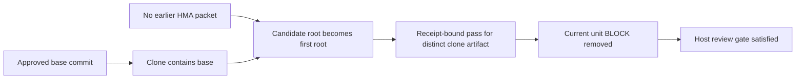

**Gate C verdict: FAIL.**

The auditor reproduced 3 defects. A first review packet can select a different checkout and remove the current unit blocker. Two unit/finding pairs can create the same core finding ID. Loop recapture can attach evidence from another root and base to an already anchored unit. The tests did not demonstrate a forged human stage approval or criterion credit.

Gate C coverage: **8 MET; 4 PARTIAL**. Prior findings: **25 FIXED; 4 PARTIAL; 7 DEFERRED-BY-HUMAN**. The accepted Gate D boundary is applied. Deferred implementation is not counted as a Gate C failure or success. The report-contract JSON encodes this FAIL verdict as `fix-required`.

**Isolation is compromised.** The session started with the assigned audit context. One command then read Gate A v3 lines 47–66 outside the permitted sections. That text describes lease rules. It does not contain a prior audit verdict. This is still a blinding breach. The auditor did not restart and does not claim fully isolated independent signoff. No optional unblinding was performed. The scope note was never read past line 86. No forbidden prior audit directory or TODO Gate C section was read.

**Target and freeze.** Branch `main`; HEAD `527b7c5ff79090c558f5bbfed5ec87a85f06d1e5`. The audit includes its uncommitted tree. `.serena/` and `docs/handoffs/2026-10-16-arch-amendment-*.md` are excluded from evaluation. Their untracked bytes were still hashed by the required freeze.

- Tracked diff SHA-256: `21af06a1bac4c6e7ea00287fd0736cff02c612b0230be4384e4c080a31444d27`.
- Canonical untracked-manifest SHA-256: `689ead81e49b9657321423170af5b2fc2bb66464e5f19db9b47bf06209294f0a`. The complete per-file inventory is in [freeze-start.json](freeze-start.json).
- Phase 1 SHA-256: `52c641ee62d28a81f399ebc23f731679d350250133a351f637764722dac2fc23`. [PHASE1.json](PHASE1.json) was frozen before any optional unblinding.
- End check at `2026-10-17T16:10:55.271795+00:00`: HEAD, branch, status, diff digest and all 29 untracked-file digests are unchanged. See [freeze-verification.json](freeze-verification.json) and [freeze-end.json](freeze-end.json).

Tests ran in [the execution copy](repo/) with `go1.27.1 linux/amd64`. `GOCACHE` is under this audit directory. Commands use `$HOME/.local/go/bin` in PATH. The original repository received no edits or Git writes. Scratch Git init, clone and commit operations occurred only under this audit output. No nested agent CLI or model API was used. The synthetic records are test evidence. They are not human approvals.

Observed flow for J8-01:

This diagram is a presentation aid. The retained packet, report, receipt and chains are the evidence. The probe did not request or record a human stage transition.

**Requirement coverage.** Requirements were derived before reading the diff. Sources are the original consolidation handoff §5–§6; the specifically authorized Gate A sections; architecture; Task 14; the audit/ledger/verify-loop contracts; and accepted scope §0.1. [REQUIREMENTS.json](REQUIREMENTS.json) preserves the initial derivation.

| ID | Status | Observed result | Evidence |
|---|---|---|---|
| GC01 | PARTIAL | Packet generation, nonce, core-state and approved-base checks work. The first packet can adopt a clone with a different head and diff. Its report removes the current unit BLOCK. J8-01. | `independent-confirmed-final.log`; `reproductions/first-root-2038237522/`; `cmd/hma/review.go:553` |
| GC02 | MET | Exact successful run, launch values, report digest, nonce and route fields are checked. Wrong or absent receipt fields refuse without chain changes. Full namespace admission is explicitly Gate D. | `independent-controls.log:TestAuditor8JReceiptMatrix`; `cmd/hma/gatec_review_import_test.go:229` |
| GC03 | MET | Malformed, incomplete, contradictory, case-variant, Unicode-fold, control-separator and invalid UTF-8 inputs do not approve or clear BLOCK. Python contract checks agree on the tested report fixtures. Exhaustive Unicode whitespace parity also passes. | `independent-controls.log:TestAuditor8JReportMatrix`; `independent-controls.log:TestAuditor8JRawParserVariants`; `independent-utf8.log`; `internal/host/gatec_r3_parity_test.go:126` |
| GC04 | MET | Executed route tests reject self/model/context reuse, earlier retained implementers, and same-family final/high/disputed routes. Final pass requires isolated report. These are deterministic checks over host-declared route facts. | `go-race-controlled-tmp.log`; `internal/host/gatec_r2_test.go:12`; `cmd/hma/gatec_r2_test.go:97`; `cmd/hma/gatec_review_import_test.go:310` |
| GC05 | MET | One concurrent import succeeds. Replay fails. A newer unanswered packet closes the gate. The new valid final report and snapshot reopen it. Core drift and live artifact drift refuse. | `independent-controls.log:TestAuditor8JConcurrentReplayAndPending`; `independent-controls.log:TestAuditor8JStaleTargetMatrix`; `cmd/hma/gatec_r2_test.go:33` |
| GC06 | PARTIAL | Non-approving snapshots preserve exact-unit BLOCK and WAIVABLE findings. Approving snapshots preserve other owners. Imports credit no criterion. Slash-containing unit/finding pairs nevertheless create duplicate global IDs and fail validator evaluation. J8-02. | `independent-controls.log:TestAuditor8JSnapshotOwnershipAndDowngrade`; `independent-confirmed-final.log:TestAuditor8JCrossUnitSlashCollision` |
| GC07 | MET | A binary compiled from baseline HEAD wrote old finding and waiver records. Current code reads them. Own-unit approval resolves owned legacy findings. Other-unit and ambiguous findings remain. Active waiver survives. Modes and manual-packet refusal pass. | `independent-controls.log:TestAuditor8JBaselineMigration`; `independent-controls.log:TestAuditor8JManualPacketAndMode`; `host-dogfood.log` |
| GC08 | MET | Review launch interval is [record timestamp, record timestamp+1 hour). Before issuance, equality at expiry and after expiry refuse. Just before expiry passes, even when import occurs later. Core-head invalidation and once-only import checks work. Lease-generation and namespace reconciliation remain Gate D. | `independent-controls.log:TestAuditor8JReceiptMatrix`; `cmd/hma/gatec_r2_test.go:118` |
| GC09 | PARTIAL | Envelope/store/run/unit bindings, argv safety, self-recapture, immutable output, exit/truncation and corruption checks work. Journal repository identity and approved base are not checked against recapture input. An existing anchored run accepts another root/base. J8-03. No criterion credit was observed. | `independent-controls.log:TestAuditor8JLoopOutputAndResidue`; `independent-controls.log:TestAuditor8JShellAndData`; `independent-loop-target.log` |
| GC10 | MET | Missing and terminal runs refuse before execution. An admitted check holds the core lock. Concurrent direct terminal append waits and then fails its stale sequence. An open-run control succeeds. Gate B crash/chain/approval/terminal regression tests pass. | `independent-controls.log:TestAuditor8JLoopClosedMissingAndLock`; `independent-controls.log:TestAuditor8JTerminalConcurrentAppend`; `go-race-controlled-tmp.log` |
| GC11 | PARTIAL | Repository failure→repair→fresh review fixture and 17-check host dogfood pass. Independent controls pass. Three independent defect probes fail as expected. A real verify-loop worker/controller launch was not executed because the current route contract only permits agent-dispatch and nested agent CLIs are forbidden for this audit. | `cmd/hma/gatec_findings_test.go:58`; `host-dogfood.log`; `independent-controls.log`; `independent-confirmed-final.log`; `independent-loop-target.log` |
| GC12 | MET | Accepted §0.1 records reservation, replay/admission/consumption, namespace association, validity generations, criterion credit, reproduced dispositions and contract-rich packet inputs with Gate D exit tests. Current import paths make no PASSED criterion or bounded-execution/closure claim. Deferred items are not counted as Gate C implementation successes. | `docs/handoffs/2026-10-16-gate-c-scope.md:17`; `docs/task14-host-orchestration.md:195`; `docs/task14-host-orchestration.md:205` |

**Reproduced findings.** All remedies below are proposed. No repository fix was made or validated.

**J8-01 — HIGH — First generated packet can adopt another checkout and clear the current blocker**

requireApprovedRepository checks the approved base and compares roots only with an earlier HMA packet. On a legacy run with no packet, a clone containing that base becomes the root anchor. The independent probe commits a different artifact in the clone, imports a receipt-bound pass, removes the unit BLOCK and satisfies the host review gate. No hostile same-UID process, forged receipt, stage approval or route substitution is required. This violates architecture §7.1 correct repository/revision identity and Gate C exact-current-target snapshot semantics. The comment that accepted-plan root binding is Gate D describes the implementation limit; it does not make a different-target resolution safe. A final stage transition on the original checkout was not demonstrated and is not claimed.

Observed evidence:

- `cmd/hma/review.go:553-579`: No prior packet means the root-comparison loop supplies no approved-root check; VerifyBase only establishes that the commit exists in the candidate checkout.
- `independent-confirmed-final.log:1-12`: TestAuditor8JFirstPacketCloneRoot records APPROVE, an empty findings snapshot and gate=<nil> for a distinct clone artifact.
- `reproductions/first-root-2038237522/`: Retains the original checkout, distinct clone checkout, core/host chains, packet, report and receipt. The earlier core record contains prior/BLOCK. The final snapshot has no findings.

Proposed remedy: Bind a trusted canonical repository root or equivalent repository identity before the first review-packet dispatch. Compare it at packet generation, review import and findings import. For legacy runs without such a binding, refuse authoritative import until an explicit trusted migration records the intended root. Do not take that binding from the first candidate packet itself.

Reason: A separately established identity closes the unanchored first-packet path while keeping the approved-base and live-artifact checks.

Verification:

- Repeat TestAuditor8JFirstPacketCloneRoot with the same-base clone and a distinct committed artifact. Fingerprint both chains. Also try a different base and a later alternate root. Expected: Every wrong target refuses before a usable packet/import/snapshot; BLOCK and both chains stay unchanged.
- Generate and import an exact independent report for the recorded approved root, then its findings snapshot. Expected: The current own-unit control can resolve findings and satisfy only the host review gate.

Trade-offs: Legacy runs need a visible trusted migration. Canonical paths must distinguish approved linked worktrees/clones according to the chosen identity contract. Existing active approvals must not be silently rebound.

Alternative: Until an approved root binding is available, make initial packet imports diagnostic-only and prohibit finding resolution and host-gate satisfaction.

Effort: medium. Fix status: proposed.

**J8-02 — MEDIUM — Slash-separated finding IDs collide across exact unit owners**

UnitFindingID concatenates unit + "/" + source ID without escaping. Unit U1/sub with finding F and unit U1 with finding sub/F both become U1/sub/F. SnapshotFindings preserves both owners and the store accepts duplicate global IDs. The independent probe passes the resulting advisory-only state to the existing validator-contract evaluator, which refuses DUPLICATE_FINDING_ID. This is a finding-model integration and resolution-identity defect. No cross-unit BLOCK deletion was observed.

Observed evidence:

- `internal/host/findings_import.go:46-49,68-85`: Tuple encoding is ambiguous; preserving a different owner and adding a colliding imported finding creates two identical ID values.
- `independent-confirmed-final.log:13-26`: TestAuditor8JCrossUnitSlashCollision stores two ADVISORY/PARK findings owned by U1/sub and U1; validator evaluation returns REJECTED/DUPLICATE_FINDING_ID.
- `reproductions/slash-collision-2296689647/`: Retains packet, report, receipt and both committed chains for the colliding snapshot.

Proposed remedy: Use an unambiguous encoding of the (unit ID, source finding ID) pair, or reject a global-ID collision before any snapshot append. Preserve original source IDs and migrate existing references and active waiver targets explicitly.

Reason: Every finding must have one unambiguous identity in the core APIs that address findings by ID. UnitID ownership alone does not make global IDs unique.

Verification:

- Repeat the end-to-end U1/sub+F and U1+sub/F fixture, including source IDs and unit IDs with multiple slashes. Expected: Distinct findings have distinct core IDs, or the second import refuses without append. A supported advisory-only snapshot passes validator-contract evaluation.
- Re-run exact-owner preservation, legacy finding migration and active-waiver tests. Expected: No other-unit finding, waiver or reference is silently dropped, reassigned or weakened.

Trade-offs: Changing identifier encoding needs compatibility handling for existing reports, references and waivers. Rejection is smaller containment but does not support all otherwise-valid IDs.

Alternative: Restrict unit/source IDs to an explicit safe grammar at every creation and migration boundary, with visible handling of incompatible legacy IDs.

Effort: small. Fix status: proposed.

**J8-03 — MEDIUM — Loop recapture can attach another repository artifact to an anchored unit**

loop-evidence verifies the envelope digest and hma store/run/unit fields. It does not compare the journal repo identity or caller repository root/base with the unit approval or an existing generated packet. After an ordinary packet anchors root A, the independent probe supplies a state naming A but requests recapture in repository B with B's base. HMA executes true in B and appends core and host evidence under A's unit. The record exposes B's working directory/head, so this is not a demonstrated concealed criterion credit. No PASSED criterion, lease, review approval or stage advancement results. It still fails the correct-target evidence integration boundary in architecture §7.1 and §14.

Observed evidence:

- `cmd/hma/loop.go:117-147,205-235`: Admission checks open run and approved route, then captures the caller root/base. State parsing binds hma identifiers but does not consume or validate repo.root/head.
- `independent-loop-target.log`: TestAuditor8JLoopWrongTargetProbe succeeds on another root/base and records EVIDENCE_RECORDED; the test deliberately fails that outcome.
- `reproductions/`: The loop-other-root-* subdirectory retains the source state and resulting core/host chains, including the evidence output artifact.

Proposed remedy: Before execution, compare the journal repository identity and caller root/base with the independently established run/unit target. Reuse the approved base/root checks where available. On an unbound legacy run, refuse authoritative loop evidence until its intended repository identity is established.

Reason: Fresh recapture proves what ran in the selected directory; it does not establish that this was the unit's intended artifact.

Verification:

- Repeat TestAuditor8JLoopWrongTargetProbe with a correct journal/root control, wrong root, wrong approved base and same-base clone. Fingerprint both chains and use an execution marker. Expected: Wrong-target cases refuse before executing argv or appending either chain. The exact current target recaptures successfully.
- Re-run terminal-lock, output retention, mutation refusal, envelope drift and no-criterion-credit controls. Expected: Existing safe recapture behavior remains and no import credits a criterion.

Trade-offs: The journal repository schema and allowed artifact evolution must be specified. A historical journal may be a lead for a new current check, but must not silently select another repository or claim historical check authority.

Alternative: Permit explicitly labelled diagnostic capture of a foreign artifact in a separate evidence namespace that cannot serve as this unit's required evidence.

Effort: medium. Fix status: proposed.

**Prior-finding closure matrix.** Each row uses the criteria file with its prior statuses and verdicts removed. `DEFERRED-BY-HUMAN` records accepted scope. It does not mean the deferred implementation passed. Tests below are in [the independent control log](independent-controls.log), the full repository suite, or the specifically named failing-probe log. The JSON keeps each criterion and evidence pointer.

| ID | Status | Observation and reproduction |
|---|---|---|
| F01 | FIXED | Failed/escalated same-ID and omitted-ID snapshots retain prior strengths; current pass can resolve its own unit. Evidence: `TestAuditor8JSnapshotOwnershipAndDowngrade; TestGateCSnapshotNoDowngradeNoCrossUnit`. |
| F02 | FIXED | Core-head equality and append sequence reject stale findings/waiver/criterion/rewind state. Own snapshot exception is narrowly bound. Evidence: `TestGateCR2ImportsRequireCurrentCoreHead; TestGateCOtherCoreRecordAfterReviewStillStale`. |
| F03 | FIXED | Once-only and latest-packet checks reject replay; concurrent imports allow one append. Evidence: `TestAuditor8JConcurrentReplayAndPending; TestGateCReplayOfEarlierPacketRefused`. |
| F04 | PARTIAL | HMA derives exact artifact and rejects wrong declared digests, bases and later roots. Initial root is not independently bound. J8-01. Evidence: `TestGateCR2PacketDerivesArtifact; TestAuditor8JFirstPacketCloneRoot`. |
| F05 | FIXED | Final reason triggers provider/model-family separation even without FinalValidation. Normal independent control passes. Evidence: `TestGateCR2IndependenceRules; TestReviewIndependenceRules`. |
| F06 | FIXED | Wrong/missing provider and effort refuse; exact route control passes. Evidence: `TestAuditor8JReceiptMatrix`. |
| F07 | FIXED | Strict report contract and exact JSON parsing prevent malformed reports from approving or weakening findings. Evidence: `TestAuditor8JReportMatrix; TestAuditor8JRawParserVariants`. |
| F08 | DEFERRED-BY-HUMAN | Unverified kernel/budget references create no BLOCK/WAIVABLE. Real kernel/budget reproduction positive paths remain Gate D by accepted §0.1. Evidence: `TestAuditor8JReportMatrix/fake-kernel-opportunity; scope §0.1`. |
| F09 | PARTIAL | Self-recapture and durable evidence bridge exist; no criterion credit or reservation authority. Other-root/base evidence is accepted for the unit. J8-03. Real controller launch not exercised. Evidence: `TestAuditor8JLoopOutputAndResidue; TestAuditor8JLoopWrongTargetProbe`. |
| F10 | FIXED | One-hour half-open launch interval binds receipt started_at; stale core state refuses. Evidence: `TestAuditor8JReceiptMatrix; TestGateCR2ReceiptRouteRootAndWindow`. |
| F11 | FIXED | Every retained implementation contribution participates in independence checks. Evidence: `TestGateCR2ReviewerIndependentOfEveryImplementation`. |
| F12 | DEFERRED-BY-HUMAN | Accepted §0.1 preserves reservation/namespace/validity exit tests and Gate D prerequisite. No execution or closure claim is awarded. Evidence: `scope §0.1`. |
| F13 | FIXED | Legacy records remain readable; migration changes mode to packet_import and refuses new manual overrides. Evidence: `TestAuditor8JBaselineMigration; TestAuditor8JManualPacketAndMode; TestGateCLegacyReviewAfterPacketRefused`. |
| A01 | FIXED | Invalid approving reports cannot clear BLOCK or open host gate; complete current control passes after snapshot. Evidence: `TestAuditor8JReportMatrix`. |
| A02 | FIXED | Tracked/untracked live drift refuses both import stages; unchanged control passes. Dirty-worktree digest recapture also covered by repository tests. Evidence: `TestAuditor8JStaleTargetMatrix; TestGateCWorktreeChangedAfterPacketRefused`. |
| A03 | PARTIAL | Explicit UnitID preserves exact owners, including prefix units. Slash-containing identities still collide globally and break validator contract. No cross-unit BLOCK removal reproduced. J8-02. Evidence: `TestAuditor8JSnapshotOwnershipAndDowngrade; TestAuditor8JCrossUnitSlashCollision`. |
| A04 | DEFERRED-BY-HUMAN | Current packet carries core head, plan digest, criteria dispositions, findings and waiver scopes. Contract-rich standalone inputs and immutable source manifests remain Gate D by accepted §0.1. Evidence: `TestGateCR3PacketCarriesCoreState; scope §0.1`. |
| A05 | FIXED | Baseline-written own-unit findings resolve; other-unit/ambiguous findings and active waiver remain. No owner is inferred from a string prefix. Evidence: `TestAuditor8JBaselineMigration; TestGateCR3LegacyFindingOwnership`. |
| A06 | DEFERRED-BY-HUMAN | Reproduced dispositions and exact-target independent criterion-credit pairs remain Gate D. Current imports never write criterion PASSED. Evidence: `scope §0.1; TestAuditor8JSnapshotOwnershipAndDowngrade`. |
| A07 | DEFERRED-BY-HUMAN | In-scope wrong envelope/store refusals and genuine recapture controls pass. Reservation/namespace/launch reconciliation matrix remains Gate D. Evidence: `TestGateCR3LoopEnvelopeChecks; scope §0.1`. |
| A08 | FIXED | Missing/terminal runs refuse before argv. Core lock covers admission, execution and append. Evidence: `TestAuditor8JLoopClosedMissingAndLock; TestAuditor8JTerminalConcurrentAppend`. |
| A09 | FIXED | Legacy and migrated modes are visible. Manual packet and fallback dispatch are refused after migration. Evidence: `TestAuditor8JManualPacketAndMode; TestGateCR3EnforcementModeVisible`. |
| R3-01 | FIXED | Pending newer final packet invalidates earlier pass; authentic current final receipt/report/snapshot restores host gate. Concurrent duplicate imports refuse. Evidence: `TestAuditor8JConcurrentReplayAndPending`. |
| R3-02 | DEFERRED-BY-HUMAN | Standalone immutable request/criteria/non-goal/budget/evidence/policy inputs depend on the acceptance contract; accepted §0.1 preserves Gate D exit tests. Evidence: `scope §0.1`. |
| R3-03 | DEFERRED-BY-HUMAN | Lennon explicitly accepted §0.1 on 2026-10-17. Deferred proof rows remain named with Gate D exit tests; no Gate D success is inferred. Evidence: `human instruction; scope §0.1`. |
| C-F14 | FIXED | Caller Packet binding is refused before append in legacy and migrated runs. Real generated packet/import control works. Evidence: `TestAuditor8JManualPacketAndMode; TestAuditor8JReportMatrix/valid-current-control`. |
| C-F15 | FIXED | Both streams, framed digest, exit 7 and explicit output cap survive process exit; intact artifact reuse succeeds. Mutation refusal is covered by repository fixture. Evidence: `TestAuditor8JLoopOutputAndResidue; TestGateCLoopEvidenceRefusals`. |
| C-F16 | FIXED | Exact-key decoder ignores ASCII/Unicode case-fold aliases in report, receipt, binding and loop structures. Case-variant passing verdict cannot override fix-required. Evidence: `TestAuditor8JRawParserVariants; TestAuditor8JReceiptMatrix; internal/host/exact_json.go`. |
| C-F17 | FIXED | Information separators fail nonempty checks. Exhaustive Python/Go whitespace comparison covers all 0x110000 code points. Evidence: `TestAuditor8JReportMatrix/control-separator; TestGateCR6StripMatchesPython`. |
| C-F18 | FIXED | Empty/partial/symlink residue refuses before chain append and remains intact. Correct pre-existing artifact is reused. Final name uses atomic link after write+sync. Evidence: `TestAuditor8JLoopOutputAndResidue`. |
| C-F19 | FIXED | Loop and direct capture refuse shell executable/wrapper/shebang entry points; unsafe verify-loop argv controls pass. Plain binary/data controls execute. Arbitrary approved program internals remain trusted. Evidence: `TestAuditor8JShellAndData; TestGateCR7LoopEvidenceRefusesUnsafeArgv`. |
| C-F20 | FIXED | Invalid UTF-8 report, receipt and loop state refuse without approval or chain append. Evidence: `TestAuditor8JRawParserVariants/invalid-utf8; independent-utf8.log`. |
| C-F21 | FIXED | printf %s sh runs. Shell entry points remain refused. Evidence: `TestAuditor8JShellAndData`. |
| C-F22 | FIXED | Direct shell/env shebangs, symlinked interpreters, env aliases and xargs shells refuse before execution. This does not prove arbitrary executables never launch a shell internally. Evidence: `TestAuditor8JShellAndData; TestGateCR9ShellEntryPointsRefused`. |
| C-F23 | FIXED | Core lock probe sees LOCK_HELD. Direct terminal append cannot commit during capture and its stale sequence is refused afterward. Evidence: `TestAuditor8JLoopClosedMissingAndLock/core-lock-during-check; TestAuditor8JTerminalConcurrentAppend`. |
| C-F24 | PARTIAL | Wrong base and later alternate/clone roots refuse. First packet still adopts another clone/head and clears BLOCK. The code records an initial-root limitation, but that does not enforce correct-target finding resolution. J8-01. Evidence: `TestGateCR10PacketBoundToApprovedRepository; independent-confirmed-final.log`. |

**Executed verification.**

| Check | Exit | Observed result | Log |
|---|---:|---|---|
| `go test -count=1 ./...` | 1 | Initial copied-checkout TMPDIR artifact; all product packages pass. | [go-test.log](go-test.log) |
| `TMPDIR=<audit>/test-tmp go test -count=1 ./...` | 0 | All 12 packages pass before auditor additions. | [go-test-controlled-tmp.log](go-test-controlled-tmp.log) |
| `go vet ./...` | 0 | No diagnostics. | [go-vet.log](go-vet.log) |
| `go test -race -count=1 ./...` | 1 | Same initial dogfood-helper TMPDIR assumption. | [go-race.log](go-race.log) |
| `TMPDIR=<audit>/test-tmp go test -race -count=1 -skip ^TestAuditor8J ./...` | 0 | All 12 audited packages pass; no race diagnostics. | [go-race-controlled-tmp.log](go-race-controlled-tmp.log) |
| `TMPDIR=<audit> scripts/dogfood/host-dogfood.sh --keep` | 0 | 17 checks pass; scratch chain retained. | [host-dogfood.log](host-dogfood.log) |
| `go test -race -count=1 -v -run ^TestAuditor8J -skip ^TestAuditor8J(FirstPacketCloneRoot\|CrossUnitSlashCollision)$ ./cmd/hma` | 0 | 86 top-level/subtest PASS lines; final LoopWrongTarget probe was diagnostic in this controls run, then hardened and independently confirmed failing. | [independent-controls.log](independent-controls.log) |
| `go test -race -count=1 -v -run ^TestAuditor8J(FirstPacketCloneRoot\|CrossUnitSlashCollision)$ ./cmd/hma` | 1 | Two expected defect assertions fail; full reproductions retained. | [independent-confirmed-final.log](independent-confirmed-final.log) |
| `go test -race -count=1 -v -run ^TestAuditor8JLoopWrongTargetProbe$ ./cmd/hma` | 1 | Expected wrong-target refusal assertion fails. | [independent-loop-target.log](independent-loop-target.log) |
| `go test -race -count=1 -v -run ^TestAuditor8JInvalidUTF8OtherInputs$ ./cmd/hma` | 0 | Receipt and loop invalid-UTF8 controls pass. | [independent-utf8.log](independent-utf8.log) |
| `go build -buildvcs=false -o <audit>/baseline-seed ./scripts/audit-seed` | 0 | Baseline 527b7c5 model/store writes legacy records for migration test. | [baseline/scripts/audit-seed/main.go](baseline/scripts/audit-seed/main.go) |

The first `go test` and `-race` runs failed `TestSyntheticStoreRefusesNonScratchDir`. That test assumes the checkout is outside the system temporary directory. The isolated checkout is under `/tmp`. A separate audit-owned `TMPDIR` restores that test condition. All 12 packages then pass. The initial failure is retained and is not presented as a product regression.

The independent control log has 86 PASS lines, including top-level tests and subtests. The final probe for J8-03 was hardened from a diagnostic observation into a required-refusal assertion after that control run. Its separate run fails as documented. The final J8-01 and J8-02 probes also fail on their required safe outcomes. No race diagnostic was reported. The exhaustive repository Unicode whitespace test compares all `0x110000` code points with Python.

An initial own assertion collapsed findings into an ID-only map. It incorrectly reported loss of an other-unit BLOCK. The stored slice retained that BLOCK. The corrected test uses the exact owner and ID. J8-02 separately proves the remaining duplicate-ID defect. Both initial and corrected logs remain available.

**Accepted deferrals and limits.** Scope §0.1 records the unchanged Gate D tests for reservation replay, admission, consumption, unknown launches, namespace association, half-open lease generations, independent criterion credit, reproduced kernel/budget dispositions and contract-rich packet inputs. Gate C does not claim those tests passed. The code does not write criterion `PASSED` on import. The loop journal and its attempt IDs grant no launch authority.

No actual verify-loop controller/worker launch was run. Its current validated route contract requires `agent-dispatch`. This audit forbids nested agent CLIs. Contract-shaped state fixtures exercise HMA ingestion and fresh check execution. They do not certify real controller launch reconciliation. The failure→repair→fresh-review repository fixture and the synthetic host dogfood are separate evidence, with separate limits.

The trusted-host threat model applies. Receipt provenance detects accident and drift. It is not a same-UID adversary defense. No-shell tests cover the tested executable, wrapper, symlink and shebang entry points. They do not prove that an arbitrary allowed executable never starts a shell internally.

Jev was not available through this host. The recorded fallback decision is `stop` and return this evidence to the human/implementer path. No substitute model was called Jev. No optional redesign or unrelated cleanup is proposed.

All audit limitations are preserved in [AUDIT.json](AUDIT.json) and the frozen [PHASE1.json](PHASE1.json). Retained reproductions are under [reproductions/](reproductions/). The independent test source is [auditor_final8j_test.go](repo/cmd/hma/auditor_final8j_test.go). The baseline writer source is [baseline/scripts/audit-seed/main.go](baseline/scripts/audit-seed/main.go). [ARTIFACTS.sha256](ARTIFACTS.sha256) binds the report, logs and reproduction files.

**Single next action (§18): REMEDIATE.** Lennon should assign the existing authorized Gate C implementer to correct J8-01 through J8-03. The owner must use the current approved route and bounded repository permission envelope. This auditor cannot attest the current route identity or approval challenge. Any required rewind or route/unit transition needs its normal fresh challenge-bound human approval. Stop if the correction would widen permissions or change the accepted Gate D boundary. Gate C needs a fresh-context independent audit of the corrected exact target before acceptance.
