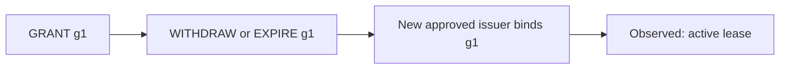

# Gate D D1+D2 audit

**Verdict: FAIL.** One high-severity defect remains. This decision applies to D1+D2 only.

The real transition path accepts an issuer bound to an inactive or replaced waiver grant. Pure lease derivation then reports an active lease. The repository's full test, vet, and race runs pass. Independent tests reproduce the defect in normal and race modes.

Twelve of the 13 supplied prior finding closure checks are **FIXED**. `D12R5-01` is **PARTIAL**. D1 is **MET** within this scope. D2 is **PARTIAL** because waiver provenance at issuance remains unsound.

## Target, independence, and scope

- Dispatch: `hma-gate-d-audit-20261017-d12r6`.
- Branch: `main`. HEAD: `bc5acb7c0bdc634f31a0644ee17d0f610d7f4be0`.
- Working-tree diff SHA-256: `c119b7f95c3cff42c5a2f13037bbef88fefbde6093a55c355a1ccbe64dca19fb`.
- All visible untracked file SHA-256 values: [freeze-start.json](freeze-start.json).
- Freeze verification: HEAD, status, diff, and untracked hashes are unchanged. See [freeze-end.json](freeze-end.json) and [freeze-verification.json](freeze-verification.json).
- Isolation: **isolated** audit context. The initial inputs contained the original objectives and closure criteria with judgments removed. No earlier audit directory was read. Natural source comments and test names mention earlier findings; they were treated as audited artifacts.
- The dispatch brief declares Liz / `gpt-6.1-sol` / high / review mode. This session has no independent route attestation. It used no nested agent CLI, model API, or additional agent.
- No approved Jev tool is exposed. Auditor judgment is the recorded fallback. It grants no authority.
- The target repository was read-only. Tests ran in a byte-verified copy of 216 files. Auditor code was added through a Go overlay. Cache and temporary test state were confined to the output directory in final runs.
- `.serena/` and `docs/handoffs/2026-10-16-arch-amendment-*.md` were excluded from evaluation. Their visible untracked hashes were retained in the freeze manifest. D3-D6 execution, reservation, reconciliation, credit, disposition, and amendment work were excluded.

Authoritative requirements came from outcome-consolidation §5, Gate A v2 §2.2, v3 §2.1-§2.3, v4 §1-§2, architecture §§5, 6, 10, 18, and `AGENTS.md`. Only the requested Gate A sections were printed with `sed` ranges. See [requirements-sources.txt](requirements-sources.txt), [requirements-source-sha256.json](requirements-source-sha256.json), and [requirements-derived.json](requirements-derived.json). Requirements and failure hypotheses were written before the diff was inspected.

## Requirement coverage

| ID | Result | Observation | Test evidence |
| --- | --- | --- | --- |
| D1-01 | MET | Versioned definitions and ceilings exist. Recursive field controls pass. Results remain in core records. | `auditor-test.log:TestAuditEveryDocumentField`, `auditor-test.log:TestAuditMaterialDigestChanges` |
| D1-02 | MET | Malformed Unicode, unknown/duplicate keys, and trailing documents refuse. Valid Unicode and canonical key ordering pass. Material changes alter digests. Exact criterion-ID controls pass. | `auditor-test.log:TestAuditUnicodeAndStrictness`, `auditor-test.log:TestAuditMaterialDigestChanges`, `criterion-controls.log`, `criterion-controls-race.log` |
| D1-03 | MET | Real Apply refuses unbound, dropped, swapped, and wrong-byte contracts. A legal rewind permits a new contract. Empty additive field preserves old approval bytes. | `auditor-test.log:TestAuditLegacyApprovalBytes`, `auditor-test.log:TestAuditApplyContractBindings`, `auditor-test.log:TestAuditLaterContractCannotDropOrSwap` |
| D1-04 | MET | Missing/null fields refuse in parsing and lease derivation. Explicit permitted empty arrays and zero retries pass. Existing graph validation controls pass. | `auditor-test.log:TestAuditEveryDocumentField`, `auditor-test.log:TestAuditAllPlanDeclarationsRefuseLease` |
| D2-01 | MET | Wrong, absent, unapproved, and illegal issuers refuse. Exact plan and contract binding pass. Legal independent-validation rework passes. | `auditor-test.log:TestAuditIssuerAndTerminal`, `auditor-test.log:TestAuditLeaseRouteAndCeilings` |
| D2-02 | MET | Missing selection and identity, permission, approval-reference, or unit mismatches refuse. Read-only controls pass; bounded-write broadening refuses. | `auditor-test.log:TestAuditLeaseRouteAndCeilings`, `auditor-test.log:TestAuditReadOnlyRoute` |
| D2-03 | MET | Direct/transitive invalidation passes. Real global Grounding and Release-and-closure → Acceptance-criteria rewinds void old leases with empty, self, and unrelated unit tags. Only a fresh issuer resumes. | `auditor-test.log:TestAuditRewinds`, `auditor-test.log:TestAuditRealGlobalRewind`, `auditor-race.log:TestAuditRealGlobalRewind` |
| D2-04 | MET | Real Apply permits an otherwise valid old approval, but derivation refuses its expired one-minute lease. Nanosecond, negative counter, equality, and policy controls pass. | `auditor-test.log:TestAuditCountersTimePolicy`, `auditor-test.log:TestAuditRealApplyLateApproval` |
| D2-05 | MET | The independent reference digest agrees. Each specified identity field changes the digest. Repeated input is deterministic. | `auditor-test.log:TestAuditIdentity`, `auditor-test.log:TestAuditIdentityFieldsIndependently` |
| D2-06 | PARTIAL | Post-issuer invalidation passes. A fresh issuer can bind a pre-issuer withdrawn, expired, or replaced grant and obtain an active lease. See D12R6-01. | `auditor-test.log:TestAuditWaiverAfterIssuer`, `auditor-test.log:TestAuditWaiverInvalidAtIssuer`, `auditor-test.log:TestAuditRealApplyWaiverGeneration`, `auditor-race.log:TestAuditRealApplyWaiverGeneration` |
| S-01 | MET | The clean full test, vet, and race runs pass. The handoff explicitly defers D3-D6 and full Gate D completion. | `final-test.log`, `final-vet.log`, `final-race.log` |

The JSON report retains each full requirement, source locator, and evidence reference. A passing scope row does not claim launch enforcement. D2 is a pure derivation interface at this stage.

## Reproduced finding: D12R6-01

**High / observed / proposed fix.** A new issuer can bind an inactive or replaced waiver grant and obtain a lease.

Observed real-store cases:

| History before new issuing approval | Issuer binding | Projected scope state | Observed lease | Required result |
| --- | --- | --- | --- | --- |
| GRANT g1 → WITHDRAW | g1 | inactive | active | refuse |
| GRANT g1 → EXPIRE | g1 | inactive | active | refuse |
| GRANT g1 → WITHDRAW → GRANT g2 | g1 | active under g2 | active | refuse |
| GRANT g1 → WITHDRAW → GRANT g2 | g2 | active under g2 | active | active |

Each waiver operation passes `EvaluateResolution`. Each issuing transition passes real `transition.Apply`. The store validates and reloads the chain. The failing result is `ReasonNone` from `DeriveLease`, printed as `derive="" lease_active=true`. No hostile operating system, fabricated loaded record, or stage decision made by the lease function is required. This reproduction uses a **fresh** human approval with stale waiver data. It does not show an old issuer reviving without a fresh approval.



The diagram is a presentation aid. The stored chains and executable tests are the evidence.

Evidence:

- `internal/engine/lease.go:236-249`: the prefix scan maps every historic GRANT digest to a scope. The later scan begins at `issuer+1`.
- `internal/transition/apply.go:135-157`: stage and contract checks accept the issuer without validating the active grant generation.
- `internal/model/types.go:130-132`: `ActiveWaivers` is a set of **active** waiver-operation digests.
- [auditor-test.log](auditor-test.log) and [auditor-race.log](auditor-race.log): `TestAuditRealApplyWaiverGeneration` fails for withdrawn, expired, and old-after-regrant references. The current-generation control passes.
- [auditor-test-waiver-withdrawn.json](auditor-test-waiver-withdrawn.json) and [auditor-race-waiver-old_after_regrant.json](auditor-race-waiver-old_after_regrant.json): retained store-loaded chains, documents, bound digests, and active flags. Equivalent packets exist for every real-path case.
- `TestAuditWaiverInvalidAtIssuer` also accepts duplicate bound references. Duplication alone has not been shown to widen permission. It is secondary evidence of missing canonical-set validation.

**Diagnosis:** the implementation proves that a bound digest once named a GRANT. It does not prove that this grant was live when the issuer was approved. A prior withdrawal, expiration, or replacement lies before the scan window. The existing after-issuer invalidation fix works for its tested cases.

**Preferred fix, proposed:** replay the pre-issuer waiver history into a live grant-digest map keyed by canonical scope. Require every bound digest to identify that live generation. Reject absent, inactive, replaced, duplicate, or ambiguous references. Preserve the existing after-issuer invalidation check. Share this check with transition admission where practical. The lease check must still protect historic accepted issuers.

**Verification:** make every stale-reference subtest in `TestAuditRealApplyWaiverGeneration` refuse at Apply or derivation. Keep the current-generation control active. Run `TestAuditWaiverAfterIssuer`, `TestAuditWaiverInvalidAtIssuer`, all route/rewind/time/legacy controls, and the full test/vet/race suite. Repeat in a fresh isolated audit of the frozen repair.

**Trade-offs:** the current resolution projection stores boolean scope activity. The fix must also preserve grant identity. Legacy snapshots without unique grant provenance must fail closed. Some historic invalid issuers will stop obtaining leases. No approval field or digest-format change is needed.

**Alternative:** temporarily refuse every waiver-bound lease. This contains the gap but blocks valid waived work. Admission-only validation leaves historic accepted issuers exposed unless those issuers are invalidated.

**Effort and priority:** small; first priority. The fix remains proposed. This audit made no repair.

## Prior finding closure

| ID | Closure | Independent evidence |
| --- | --- | --- |
| F01 | FIXED | `TestAuditLeaseRouteAndCeilings`, `TestAuditReadOnlyRoute` |
| F02 | FIXED | `TestAuditRewinds`, `TestAuditRealGlobalRewind` |
| F03 | FIXED | `TestAuditCountersTimePolicy`, `TestAuditRealApplyLateApproval` |
| F04 | FIXED | `TestAuditUnicodeAndStrictness`, `TestAuditMaterialDigestChanges` |
| F05 | FIXED | `TestAuditEveryDocumentField`, `TestAuditAllPlanDeclarationsRefuseLease` |
| F07 | FIXED | `TestAuditTwoCriteriaDrift`, `criterion-controls.log`, `criterion-controls-race.log` |
| F06 | FIXED | `TestAuditApplyContractBindings`, `TestAuditLaterContractCannotDropOrSwap` |
| F08 | FIXED | `TestAuditIdentity`, `TestAuditIdentityFieldsIndependently` |
| F09 | FIXED | `TestAuditCountersTimePolicy` |
| D12R2-01 | FIXED | `TestAuditEveryDocumentField`, `TestAuditAllPlanDeclarationsRefuseLease`, `TestAuditMissingRetryCannotObtainLease`, `TestAuditLegacyApprovalBytes`, `final-test.log`, `final-vet.log`, `final-race.log` |
| F-D12R3-01 | FIXED | `TestAuditRealGlobalRewind`, `TestAuditRewinds`, `auditor-race.log`, `final-test.log`, `final-vet.log`, `final-race.log` |
| D12R4-01 | FIXED | `TestAuditLeaseRouteAndCeilings`, `TestAuditReadOnlyRoute`, `final-test.log`, `final-vet.log`, `final-race.log` |
| D12R5-01 | PARTIAL | `TestAuditWaiverAfterIssuer`, `TestAuditWaiverInvalidAtIssuer`, `TestAuditRealApplyWaiverGeneration`, `auditor-race.log` |

`D12R5-01` now handles withdrawal, expiration, replacement, and missing references after issuance. Its stronger provenance condition remains open as `D12R6-01`. The supplied criteria were not changed. Prior auditors' code and verdicts were not imported.

## Verification and reproducibility

| Check | Exit | Evidence |
| --- | --- | --- |
| `go test -count=1 ./...` | 0 | [final-test.log](final-test.log) |
| `go vet ./...` | 0 | [final-vet.log](final-vet.log) |
| `go test -race -count=1 ./...` | 0 | [final-race.log](final-race.log) |
| Auditor overlay, normal | 1, expected audit failure | [auditor-test.log](auditor-test.log) |
| Auditor overlay, race | 1, same defect | [auditor-race.log](auditor-race.log) |
| Two-criterion missing/renamed/extra/duplicate/disposition controls | 0 in normal and race | [criterion-controls.log](criterion-controls.log), [criterion-controls-race.log](criterion-controls-race.log) |

Toolchain: `go1.27.1 linux/amd64` from `/home/yeli/.local/go/bin`. Go module minimum: `go 1.21`. Exact commands, working directories, exit codes, durations, and final baseline environment values are retained in the adjacent `*.meta.json` files. The final baseline covers all 12 packages, including existing transition, Gate B, and Gate C tests.

All independent test inputs and assertions remain available in [overlays/model_test.go](overlays/model_test.go), [overlays/engine_test.go](overlays/engine_test.go), [overlays/transition_test.go](overlays/transition_test.go), and [overlay.json](overlay.json). The copy has identical evaluated source bytes; see [copy-sha256.json](copy-sha256.json) and [copy-verification.json](copy-verification.json).

To reproduce the primary failure without overwriting evidence:

```sh
cd /tmp/hma-gate-d-20261017-d12r6/repo
PATH=/home/yeli/.local/go/bin:/usr/bin:/bin \
GOCACHE=/tmp/hma-gate-d-20261017-d12r6/gocache \
GOTMPDIR=/tmp/hma-gate-d-20261017-d12r6/runtime-tmp \
TMPDIR=/tmp/hma-gate-d-20261017-d12r6/runtime-tmp \
go test -overlay /tmp/hma-gate-d-20261017-d12r6/overlay.json \
  -count=1 -v ./internal/transition -run '^TestAuditRealApplyWaiverGeneration$'
```

Add `-race` for the race reproduction. Expected exit: 1. Three stale-grant subtests fail. The current-grant control passes.

Early full-suite attempts used unsuitable temporary paths. The first copy-under-`/tmp` run violated a scratch-directory test assumption. The second attempt set `TMPDIR` and `GOTMPDIR` to different directories. One early race run also picked up auditor files before they were moved into an overlay. These diagnostic logs are retained as `test.*`, `race.*`, and `baseline-*`. They are superseded by the clean `final-*` baseline runs. No implementation failure is inferred from those harness errors.

## Phase 1 and controlled unblinding

Phase 1 SHA-256: `a424d7a64bb49b55a35f22b95b19830c7705983c1aca7654a27cd47f9972738e`. See [PHASE1.json](PHASE1.json) and [PHASE1.sha256](PHASE1.sha256). The file was written and hashed before the implementer handoff was read. It was not overwritten.

After the freeze, only `docs/handoffs/2026-10-17-gate-d-d1-d2.md` was unblinded. It explicitly defers D3-D6 and full Gate D completion. Its r5 claim addresses changes after issuance. That claim does not resolve the observed pre-issuer provenance gap. No finding or decision changed. See [unblinding-addendum.json](unblinding-addendum.json).

## Remediation roadmap and limits

1. Keep D1+D2 from advancing while the high finding remains open.
2. Implement the bounded grant-generation check in `D12R6-01`.
3. Rerun the stated controls and obtain a fresh isolated audit of the frozen repair.

This audit does not prove all possible histories. It does not test D3-D6 or authorize a launch, commit, push, stage transition, or release. Test-created Git fixtures were temporary. No Git write targeted `/home/yeli/repos/HMA`. No nonessential redesign is recommended.

The JSON report uses the skill contract's `fix-required` value and the requested gate value `FAIL`. These express one decision. Structural validation is recorded in [report-validation.log](report-validation.log). It checks report shape, not the truth of evidence.

## Single next action (§18)

**The human reviews D12R6-01 and its bounded repair criteria.**

Owner: Lennon / human gate owner. Route: human review; no agent or model execution in this action. Permission envelope: read-only packet review. Rationale: one reproduced high-severity defect remains. Exact approval: this audit requests no transition or repair approval. Any later repair dispatch and stage decision use normal HMA route preflight and applicable human approval. Stop if the finding remains unresolved. Escalate any proposed change to the criteria, safety kernel, approval binding, or permission envelope.
