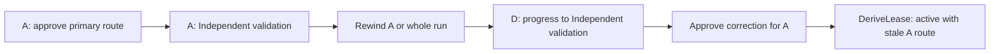

**Gate D D1+D2 audit — FAIL**

Dispatch: `hma-gate-d-audit-20261017-d12r8`. Date: 2026-10-17 America/Toronto; evidence timestamps use UTC.

Observed: A real `transition.Apply` chain obtains an active lease from a route approval invalidated by a Planning rewind. A second case changes the plan route after a Grounding rewind. The lease still accepts the old route approval. Both cases reproduce under the race detector. One high-severity finding remains: **F-D12R8-01**.

Observed: The original tests, `go vet`, and original race tests pass. The target repository is unchanged. D1 requirements are MET. D2 is incomplete. The closure table has 13 FIXED, 2 PARTIAL. These statuses assess the supplied closure criteria; they do not certify all of Gate D.

Isolation: **partial**. This is a fresh audit task. No D1/D2 implementer handoff or earlier audit file was read before Phase 1. The initial heading search accidentally displayed Gate A v3 §1 rows R1/A1 and headings outside the requested sections. This broke strict section isolation. No clean-isolation certification is claimed. No nested agent CLI, model API, coding worker, or Jev tool was used. Jev was unavailable in the exposed host tool inventory.

Scope: code and outcome review of D1 contract/plan/binding and D2 pure lease derivation. The trusted-host threat model applies. D3–D6 are excluded. The existing host does not yet consume `DeriveLease`; this report does not claim a current host launch bypass.

**Target and frozen evidence**

- Repository: `/home/yeli/repos/HMA`, branch `main`. HEAD: `bc5acb7c0bdc634f31a0644ee17d0f610d7f4be0`.
- Binary diff SHA-256: `c119b7f95c3cff42c5a2f13037bbef88fefbde6093a55c355a1ccbe64dca19fb`.
- [Start freeze](freeze-start.json) records status and SHA-256 for every Git-visible untracked file. [End freeze](freeze-end.json) matches HEAD, status, diff and all untracked hashes exactly. Excluded files were hashed but not substantively audited.
- [Evidence inventory](evidence-inventory.json) records primary-source, changed-file and test-source hashes. All 10 changed/new audited repository files match the test copy. The audit ignored `.serena/` and the two `2026-10-16-arch-amendment-*.md` files.
- [Requirements before diff](requirements-before-diff.json) preserves the blind requirement reconstruction. [PHASE1.json](PHASE1.json) was frozen before the withheld handoff was read. SHA-256: `097c413fccd603832381674867d13cd9869ae8cd56b765c46ad0670df64a64df`.
- Tests ran in `repo/` under this audit directory. `GOCACHE`, `TMPDIR`, and `GOTMPDIR` are under this directory. Go: `go1.27.1 linux/amd64`. Git resolves to `/usr/bin/git`. The target was operationally read-only; it was not mounted read-only. Temporary Git fixtures were created only under the audit directory.

Authoritative sources: the outcome-consolidation handoff §5 Gate D; Gate A v2 §2.2; Gate A v3 §2.1–§2.3; Gate A v4 §1–§2; architecture §5, §6, §10, §18 and §19; `AGENTS.md`. The latest design wins. The requested Gate A sections were printed with `sed` ranges. The initial heading-search exception is disclosed above. Prior closure criteria came only from `/tmp/hma-gate-d-criteria/criteria-d12r8.json`. Historical audit overlays were not read.

**Requirement coverage**

| ID | Required behavior and source | Assessment | Observation |
|---|---|---|---|
| D1-01 | Versioned immutable canonical acceptance contract contains run, scope, non-goals, criteria statements/checks/thresholds/evidence, risk, deliverables and ceilings. Source: v2 §2.2; v3 §2.1 | **MET** | Strict canonical contract parsing accepts complete explicit documents. Exhaustive missing/null-field tests and Unicode/digest tests pass. Results remain in core criterion records. |
| D1-02 | Core criterion IDs exactly equal contract IDs; contract edits change digest; malformed/ambiguous input fails closed. Source: v2 §2.2 | **MET** | Changed material text changes the digest. Invalid UTF-8, lone surrogates, duplicate/case/unknown keys and trailing documents refuse. Criterion rename, missing, extra and duplicate ID controls refuse; disposition-only change preserves the ID-set check. |
| D1-03 | Optional acceptance_contract_digest preserves legacy bytes; first acceptance binds a presented contract; later approvals retain exact binding; changes need approved acceptance rewind. Source: v3 §2.1; architecture §5–6 | **MET** | Real Apply refuses presented-unbound, digest-without-document, wrong digest, later drop, swap and wrong document. Both-absent legacy, exact match, carried binding and new acceptance after approved Grounding/Acceptance rewind pass. Golden legacy approval JSON bytes match. |
| D1-04 | hma.plan/v1 canonical document validates every architecture §10 field, max wall time, cost and required effective policy digest; accepted_plan_digest binds it. Source: v3 §2.2; v4 §2 | **MET** | Every declared object field is removed and set to null independently for contracts and all four plan units. Each malformed document refuses. Explicit zero retries, empty argv/non-goals/dependencies controls pass. Unit budgets, graph validation and policy/contract binding have passing independent or original controls. |
| D2-01 | Only latest legal approved transition targeting IMPLEMENTATION_AUTHORIZATION issues a lease for its exact unit and plan. Legacy/missing/invalid plan refuses. Source: v4 §1; v3 §2.3 | **PARTIAL** | Initial issuer and document/plan/unit checks pass. A fresh correction issuer can reuse an earlier invalidated route approval. The actual global-core Apply path accepts this history; see F-D12R8-01. |
| D2-02 | Run nonterminal and unit in implementation authorization; rewinds void same unit, transitive dependents or entire run as scoped. Old generations never revive. Source: v3 §2.2–2.3; architecture §5 | **PARTIAL** | Post-issuer whole-run and direct/transitive dependency rewinds refuse; unrelated units remain active. New route issuers resume. Invalidation before a correction issuer is not replayed for its retained route approval; see F-D12R8-01. |
| D2-03 | Approval wall-time interval and all per-unit ceilings enforced; counters cannot widen grant; current policy and contract equal approved binding. Source: v3 §2.2; v4 §2 | **MET** | Now before approval and exact expiry refuse; one nanosecond before expiry succeeds. Real Apply with a two-minute-old approval and a one-minute lease remains expired. Negative/equal counters and changed/empty policy refuse. Valid below-ceiling inputs pass. |
| D2-04 | Route/permission/budget/risk grants stay within contract ceilings and selected core route approval identity; conflicts refuse, including rework. Source: v2 §2.2; architecture §5–6,10 | **NOT MET** | Contract route, permission, attempt, wall-time and cost ceilings refuse broadening. Projection identity/reference/unit mismatch controls pass. However, a changed plan can select fallback while reusing the old primary route approval after a Grounding rewind. DeriveLease returns ReasonNone through a real Apply chain. |
| D2-05 | Lease identity is digest of approval transition digest, unit and plan digest; pure derivation grants no transition authority. Source: v3 §2.2; architecture §5–6 | **MET** | Independent reference SHA-256 of transition_digest, unit_id and plan_digest equals the implementation. Supplemental controls vary every identity field independently; identical input is deterministic and record-anchor edits preserve the digest. Host-written evidence and illegal issuing edges remain negative controls in the original suite. Pure derivation performs no I/O or stage advancement. |
| D2-06 | Bound waiver changes invalidate issuing and retained route approvals; inactive/replaced grants cannot issue fresh valid lease. Source: architecture §5.4,6 | **MET** | Independent pure and real Apply controls refuse bound withdrawal, expiry, replacement, old grant at issuer, unknown and duplicate references. Current regrant, unbound, unrelated and freshly approved route controls succeed. Corrections do not restore routes invalidated by waivers. |
| SCOPE | D1/D2 preserve existing transition, Gate B/C behavior and make no implementation/completion claim for D3–D6. Source: Gate D objective; user scope | **MET** | Original suite and vet/race pass. Post-freeze handoff inspection explicitly defers D3–D6 and does not claim complete Gate D. Pure lease derivation remains unwired to a command. |

Evidence: [normal auditor log](auditor-tests.log), [race auditor log](auditor-race.log), [supplement](supplement.log), [race supplement](supplement-race.log), and the test sources listed in the evidence inventory. `PARTIAL` means some controls pass but an observed counterexample remains. It maps to a failed mandatory requirement in the machine report.

**Verification ledger**

| Check | Exit | Observation | Evidence |
|---|---:|---|---|
| `go test -count=1 -skip ^TestAuditor ./...` | 0 | Pass | [original-tests.log](original-tests.log) |
| `go vet ./...` | 0 | Pass | [vet.log](vet.log) |
| `go test -race -count=1 -skip ^TestAuditor ./...` | 0 | Pass | [original-race.log](original-race.log) |
| `go test -count=1 -v ./internal/model ./internal/engine ./internal/transition -run ^TestAuditor` | 1 | Expected audit failure: retained-route rewind cases return active leases | [auditor-tests.log](auditor-tests.log) |
| `go test -race -count=1 -v ./internal/model ./internal/engine ./internal/transition -run ^TestAuditor` | 1 | Expected audit failure: retained-route rewind cases return active leases | [auditor-race.log](auditor-race.log) |
| Supplemental identity, multiple-waiver and Release→Acceptance controls, normal and race | 0 / 0 | Pass | [commands and exit codes](supplement-checks.json) |

The first unmodified-copy `go test ./...` also passed: [raw log](go-test.log). The original-suite runs use `-skip ^TestAuditor` to exclude only auditor-added tests. They include existing transition, Gate B and Gate C tests. The full initial race run with adversarial tests failed on the observed defect: [raw log](go-race.log). The final auditor race log includes the stronger changed-plan reproduction. No data-race diagnostic was observed. An exit code of 1 here records a failed safety assertion, not a successful acceptance check.

Independent controls include recursive omission/null tests for every contract/plan field, malformed Unicode and canonical equivalence, legacy approval bytes, exact contract acceptance/carry/rewind, real late approval, ceiling boundaries, core-ID drift, direct/transitive dependency rewinds, whole-run unit tags, all lease identity fields, and waiver history before/after issuance. The preserved auditor sources are [documents](repo/internal/model/auditor_documents_test.go), [lease](repo/internal/engine/auditor_d12_test.go), [lease supplement](repo/internal/engine/auditor_supplement_test.go), [Apply](repo/internal/transition/auditor_apply_test.go), [Release rewind](repo/internal/transition/auditor_release_test.go), and [fixture](repo/internal/auditfixture/fixture.go).

**F-D12R8-01 — retained route survives a rewind**

Severity: **high**. Certainty: **observed**. Mode: code and outcome. Fix status: **proposed**. This blocks scoped D1/D2 acceptance.

Observed behavior: `TestAuditorD12RealApplyInvalidatedRoute/A` and the whole-run case accept every transition through `Apply`. `DeriveLease` then returns `ReasonNone` using A’s pre-rewind route approval, `transition-audit-4`. The unrelated D control stays active. The fresh-route control stays active. `TestAuditorD12RealApplyChangedPlanRoute` also returns `ReasonNone` after A’s plan route changes from `primary` to `fallback` following a unit-tagged Grounding rewind and renewed acceptance.

The changed-plan variant returns through Acceptance criteria and Planning before D progresses. Its raw records preserve the old and new plan digests. See [reproduction summary](reproduction-summary.json) and [last-run raw traces](traces/). The returned lease is a new lease generation. The defect is reuse of an invalidated route approval, not reuse of the old lease digest.

Root cause: `internal/engine/lease.go:160–189` scans invalidating transitions only after the latest lease issuer. `:194–203` retrieves the earlier route approval and checks only its waiver validity. `routeApprovalFor` at `:305–313` selects the latest matching historical route approval without replaying Planning or whole-run invalidation. A correction issuer therefore hides invalidation that occurred after the route approval but before that issuer.

Requirement: architecture §5.4 says a plan rewind invalidates that unit’s route and downstream packets. Grounding and criteria changes invalidate the run’s downstream approvals. Gate A v2 §2.2 gives the core route approval authority over route identity. A later correction approval cannot make an invalid route approval current. No stage was advanced without a human approval in this reproduction; the pure lease evaluator gives the resulting chain too much authority.

Preferred fix, not yet validated: replay the retained route approval’s applicable invalidation history through the correction issuer and current tail. Apply whole-run and unit scope correctly. Use the approved plan graph where the invalidation rule requires it. Refuse a correction that retains an invalid route approval. Require a fresh `ROUTE_SELECTION -> IMPLEMENTATION_AUTHORIZATION` approval. Do not fall back to an older approval.

Verification: both affected Planning cases and the changed-plan Grounding case must refuse in normal and race modes. The unrelated-unit, ordinary legal correction, fresh-route, waiver, counter, wall-time and legacy-byte controls must keep passing. Re-run the original tests/vet/race. Then obtain a clean isolated follow-up audit. These are falsifiable exit criteria; this audit did not implement or validate a fix.

Trade-off: a scan that treats every forward transition as invalidation would reject valid correction. The fix must distinguish forward progress, unrelated activity and invalidating rewinds. Effort: **medium**. Containment: refuse the affected correction paths until route reapproval. Alternative: derive an explicit per-unit route-generation validity projection from the core chain. This centralizes lifecycle rules but requires more plumbing than a scoped replay guard.

**Prior finding closure**

| Prior ID | Closure | Evidence and qualification |
|---|---|---|
| F01 | **FIXED** | TestAuditorD12BoundsAndIdentity rejects out-of-contract routes and permission broadening; matching controls pass. Retained-route generation defect is separate. |
| F02 | **FIXED** | TestAuditorD12Rewinds rejects direct/transitive dependency corrections and route/plan rewinds, preserves unrelated units and permits a new route issuer. No old post-issuer generation revives in these controls. |
| F03 | **FIXED** | TestAuditorD12RealApplyLateApproval and boundary controls enforce human approval time, not append time. |
| F04 | **FIXED** | TestAuditorD12UnicodeAndCanonicalIntegrity rejects both malformed UTF-8 controls and multiple lone surrogates for both formats; valid scalar/paired-surrogate/U+FFFD controls pass. |
| F05 | **FIXED** | TestAuditorD12AllFieldsDeclared exhaustively removes/nulls each field in complete units; ParsePlan rejects them. Independent missing-retry derivation refuses before active lease. |
| F07 | **FIXED** | TestAuditorD12Rewinds rejects renamed/missing/extra/duplicate core IDs and accepts disposition-only updates with the same IDs. |
| F06 | **FIXED** | TestAuditorD12ApplyContractBinding reproduces presented-unbound refusal and both-absent, matching and mismatched controls through real Apply. |
| F08 | **FIXED** | TestAuditorD12BoundsAndIdentity computes the independent reference digest using Approval.TransitionDigest. TestAuditorD12EachLeaseIdentityField varies transition, unit and plan independently; every change changes the digest. Identical inputs are deterministic and record-anchor-only edits preserve it. |
| F09 | **FIXED** | TestAuditorD12BoundsAndIdentity independently rejects negative attempts/cost and equal-ceiling controls; zero/below controls pass. |
| D12R2-01 | **FIXED** | Exhaustive recursive missing/null field tests pass. Explicit zero retries/empty argv controls pass. Missing-retry plan cannot derive a lease. Original test/vet/race and legacy-byte control pass. |
| F-D12R3-01 | **PARTIAL** | Post-issuer Grounding/Acceptance rewind controls now refuse regardless of unit tag; real Release-and-closure -> Acceptance rewind and fresh-issuer controls also pass. A later correction can still reuse a route from before a whole-run rewind, including a changed plan route. Therefore the broader no-remaining-rewind-bypass exit criterion is not met. See F-D12R8-01. |
| D12R4-01 | **PARTIAL** | Fixed-plan selected profile, permission, approval-reference and unit controls pass, as does ordinary rework. Cross-generation coherence remains incomplete: a changed plan selects fallback using a stale primary approval. See F-D12R8-01. |
| D12R5-01 | **FIXED** | TestAuditorD12Waivers and real Apply generation controls cover bound/unbound/unrelated scopes, replacement and fresh current issuers. Missing/duplicate references refuse. Earlier generations remain invalidated. |
| D12R6-01 | **FIXED** | TestAuditorD12RealApplyWaiverGeneration refuses withdrawn/expired/old-after-regrant and accepts current-after-regrant. Pure controls also cover changes before and after the issuer. |
| F-D12R7-01 | **FIXED** | Waiver-specific retained-route controls refuse route_withdraw/route_expire/route_replace even when the correction binds current waivers. route_fresh passes. This does not establish route validity after non-waiver rewinds. |

The supplied earlier test names describe criteria. I recreated equivalent controls in new tests. I did not load those historical tests or earlier verdicts. The narrow waiver fix in F-D12R7-01 is FIXED. It does not close the distinct rewind defect in F-D12R8-01.

**Controlled-unblinding addendum**

After Phase 1 was hashed, I read `docs/handoffs/2026-10-17-gate-d-d1-d2.md`. Its frozen SHA-256 is `d216fa410b31fe3a953b52c7c13fc5397b22dfb303d2f64ac7e398d61b4df72e`. It explicitly defers D3 reservations, D4 launch reconciliation, D5 criterion credit/findings/full packet and D6 architecture amendment. It does not claim complete Gate D. It says pure derivation is not wired to a command. The current host’s conservative route rule limits present runtime exposure. These claims do not repair the demonstrated D2 result. No finding or verdict changed. No earlier audit directory was unblinded.

**Limits and remediation sequence**

- Isolation is partial because the initial heading search exposed two historical Gate A design-summary rows outside the requested source sections. This is disclosed rather than represented as a clean isolated audit.
- The trusted-host threat model is assumed. Pure LeaseRequest inputs are assumed to contain the validated core chain and honest current policy/route/counter projections. No malicious-store-forgery or host-bypass claim is made.
- Tests run on a matching source copy outside the repository. There is no OS-level read-only mount of the target; access was operationally read-only, with a start/end freeze required. Fixture git operations occur only under the audit TMPDIR.
- Original historical overlays were not read or reused. Closure criteria were reimplemented with auditor-owned controls. Closure decisions are scoped to those criteria and evidence, not a blanket assertion that Gate D is safe.
- Reservations, consumption-counter derivation, launch reconciliation, criterion credit, findings disposition and architecture amendment are D3–D6 and were not evaluated. This audit does not authorize launches or complete Gate D.
- Testing is finite. The preserved tests do not prove absence of every possible invalid history. The demonstrated high-severity defect is sufficient for FAIL.
- The handoff was read only after the Phase 1 digest was recorded. No prior audit directory was unblinded. Existing host commands do not yet consume DeriveLease. No current host launch bypass is claimed.
- Trace files retain the last full auditor race run. The earlier normal-run logs and test sources remain available. Test fixture repository paths are temporary and may have been removed by go test cleanup.

No separate redesign opportunity is proposed. The smallest useful change is the retained-route invalidation fix. The remediation sequence is containment, scoped replay fix, preserved counterexample/control tests, original regression checks, and a clean isolated follow-up audit. Exit requires all scoped mandatory requirements to be MET and no remaining high-severity finding. The optional architecture amendment and other Gate D parts remain outside this packet.

The [machine report](AUDIT.json) uses report-contract verdict `fix-required`, which maps to the single gate verdict **FAIL**. The report validator checks structure only. It does not prove the findings or a proposed fix. Raw commands, exit codes, source hashes and logs remain available in [checks](checks.json), [supplemental checks](supplement-checks.json), [inventory](evidence-inventory.json), and [artifact hashes](ARTIFACTS.sha256).

**Required next action (§18): Return the frozen F-D12R8-01 packet to the human coordinator for a bounded remediation assignment.** Rationale: the pure lease result can retain an invalid route approval. Owner: human coordinator. Route: human review; this audit dispatches no coding worker. Permission envelope: inspect this packet and assign a scoped fix; the auditor remains repository read-only. Exact approval: no stage or release approval is requested or granted; the human decides the remediation assignment. Stop/escalate: do not accept D1/D2 until the defect is fixed and independently retested; escalate any proposed change to architecture, route authority, ceilings or D3–D6 scope.
