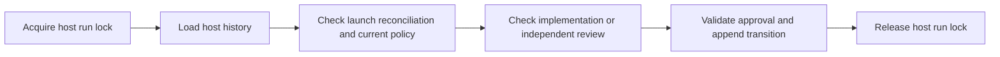

# Independent audit: current-policy transition gate

**Verdict: PASS**  
**Audit:** hma-gate-d-audit-20261019-d4pd  
**Date:** 2026-10-19T14:53:04.936345+00:00  
**Modes:** Code and outcome audit.  
**Isolation:** Isolated audit context and maintained blinding. The host and filesystem are shared. Repository access was read-only by procedure.

The target is branch `main`, HEAD `0b7aff6c9783c6d905aea72878cb037aabe1e69c`, plus the frozen working tree.
The binary diff SHA-256 is `355c1d33450e968e35be5c6df63b29d641a162477ba5138983d1ca9c3616cebf`.
The original repository is unchanged at the final check.

Lennon's authoritative decision on 2026-10-19 was:
> the transition gate must take the current policy and refuse when it differs from the policy the last launch reconciliation used.

The scoped change satisfies this decision under the trusted-host threat model.
No actionable defect was reproduced in the change.
The machine-readable contract uses `verdict: "pass"` for the same PASS verdict.

## Observed behavior

Both coding progression edges refuse a missing, unreadable, malformed or semantically different presented policy.
The gate compares canonical digests.
Equivalent JSON formatting and set ordering remain valid.
The latest reconciliation must contain the matching policy digest.
All three declared namespace forms trigger this requirement, including an empty ledger and a namespace associated with another unit.
Runs without namespaces retain their previous behavior.

A new policy requires a clean reconciliation under that policy.
Reconciliation does not erase an existing unauthorized-dispatch block.
A dated policy observation can preserve evidence that a prior review launch was authorized.
The gate reopened after clean reconciliation in that case.
An undated policy change with a prior launch remained blocked.

The CLI reads the policy inside the host run lock.
The same locked host history supplies the gate.
The lock remains held through the transition append.
A complete approved fixture transition appended one record before a contending host operation acquired the lock.

The diagram is a presentation aid. E2, E3 and E4 provide the supporting source and runtime evidence.

## Requirement coverage

| Requirement | Result | Evidence |
| --- | --- | --- |
| R1: Both implementation authorization -> review and review -> verification refuse any declared ledger namespace unless a current policy is explicitly supplied and readable. | PASS | E2, E3, E4 |
| R2: Canonical policy digest must equal the latest launch reconciliation policy digest; field-order/whitespace changes may pass, semantic policy drift must fail. | PASS | E2, E3, E4, E5 |
| R3: Reconciliation under the new policy restores eligibility only if all preexisting ledger/review/transition requirements also pass; merely presenting a changed policy must not restore eligibility. | PASS | E3, E4 |
| R4: No-ledger-namespace runs preserve existing behavior and do not acquire a policy requirement. | PASS | E2, E3, E4, E6 |
| R5: Policy comparison and ledger gate execute under host run lock on the same snapshot used for transition append. | PASS | E2, E3, E4 |
| R6: Preserve D1-D4 ledger freshness, integrity and namespace isolation plus Gate B approval binding and Gate C independent review. | PASS | E2, E3, E4, E6, E7 |
| R7: Run full go test, go vet, go test -race and independent negative controls outside repository; inspect FAIL output even on zero exit status. | PASS | E3, E4, E5, E6, E7, E8 |
| R8: Verify repository status, binary diff digest and all untracked hashes unchanged; maintain blinding through frozen Phase 1. | PASS | E1, E9 |

## Verification

| Check | Result | Complete log |
| --- | --- | --- |
| `go test -count=1 ./...` | Pass | [test.log](test.log) |
| `go vet ./...` | Pass | [vet.log](vet.log) |
| `go test -race -count=1 ./...` | Pass | [race-final.log](race-final.log) |
| Targeted audit tests | 11 top-level tests; 44 pass records including subtests | [independent.log](independent.log) |
| Targeted audit tests with race detector | Same 11 tests pass | [independent-race.log](independent-race.log) |
| Removed-policy-check negative control | Expected failure in 22 refusal subcases | [mutant.log](mutant.log) |

The checks used Go `go1.27.1 linux/amd64` from `/home/yeli/.local/go/bin`.
The cache and temporary files remained under this output directory.
`GOFLAGS=-buildvcs=false` disables VCS stamping in the source copy.
Both command status and `FAIL` lines were inspected.
No required executable failed to start.

Initial checks failed because of audit-environment settings and two audit-fixture mistakes.
E10 retains those logs.
The first review fixture lacked its required findings snapshot.
The first complete-transition fixture illegally bound produced head and diff at implementation authorization.
Those fixture errors were corrected outside the original repository.
The final normal and race checks passed.

## Evidence ledger

- **E1** — `freeze-start.json; source-manifest.json; requirements-before-diff.json`. Target frozen and requirements written before reading the scoped diff.
- **E2** — `scoped.diff; code-evidence.txt; source/`. Six changed Go files inspected. Source copy includes 164 tracked files and no handoff documents.
- **E3** — `independent-result.json; independent.log; source/cmd/hma/auditor_d4pd_test.go; source/cmd/hma/auditor_d4pd_outcome_test.go; source/cmd/hma/auditor_d4_previous_test.go`. 11 top-level tests and 44 total test/subtest pass records. Includes original policy-drift probe and three D4 regression probes.
- **E4** — `independent-race-result.json; independent-race.log`. Same 11 top-level tests pass with the Go race detector. No FAIL line or race report.
- **E5** — `mutation-overlay.json; mutant-reconcile.go; mutant-result.json; mutant.log`. Removing only the current-policy check causes all 22 policy-refusal matrix subcases to fail; current and equivalent-policy controls still pass. Expected negative-control failure.
- **E6** — `test-result.json; test.log`. Full go test -count=1 ./... passes in all 12 packages. No FAIL lines.
- **E7** — `race-final-result.json; race-final.log`. Full go test -race -count=1 ./... passes. No FAIL lines or race report.
- **E8** — `vet-result.json; vet.log; version-result.json; version.log; environment.json; run_checks.py`. go vet ./... passes. Go reports go1.27.1 linux/amd64. Runner records argument vectors, cwd, environment overrides, times, exit codes and complete output log paths.
- **E9** — `freeze-end.json; freeze-comparison.json`. All freeze comparisons match. The full binary diff hash includes the handoff file that was not semantically inspected. Untracked hashes include the ignored-from-audit paths without semantic inspection.
- **E10** — `environment-initial-test.log; environment-initial-test-result.json; environment-initial-race.log; environment-initial-race-result.json; fixture-initial-independent.log; fixture-append-initial-independent.log; race.log; race-result.json`. Retained failed audit attempts. Initial environment split GOTMPDIR from TMPDIR and omitted -buildvcs=false. Initial review fixture lacked findings import; initial full-append fixture illegally bound produced head/diff at implementation authorization. These were corrected only in the audit environment/test files. The intermediate full race execution retains the latter fixture failure.

## Findings, opportunities and remediation

There are no scoped actionable findings.
No additional design change is recommended by this audit.
No remediation is required for the evaluated change.
The independent tests remain available under `source/cmd/hma/auditor_d4*.go`.
The required exit criterion is continued agreement with the frozen target and test evidence.

## Blinding and freeze

`PHASE1.json` was written and hashed before any optional unblinding.
Its SHA-256 is `25502148a8d50e6b5c4202fb96a6801ba2e437958c400bdc456cc815f7deeedb`.
No unblinding occurred.
The final report preserves the blind findings.

[freeze-start.json](freeze-start.json), [freeze-end.json](freeze-end.json) and [freeze-comparison.json](freeze-comparison.json) record the target checks.
They match for HEAD, branch, status, binary diff and every Git-visible untracked file hash.
The copied tracked source bytes also match the original snapshot.
The excluded files were hashed for target integrity but were not semantically inspected.

## Limitations and assumptions

- Isolation is context/blinding isolation in this fresh audit session. The filesystem and OS are shared. Repository read-only behavior is procedural; the sandbox technically permits repository writes. No original repository writes were performed.
- The trusted host supplies the effective current policy path. This change does not discover an organization-wide policy or defend against a malicious host supplying an obsolete alternate file. A fully hostile host and unsynchronized external filesystem mutations are outside the stated threat model.
- Outcome checks use local synthetic stores, fixtures and approval records. They do not constitute production execution or real human authorization. Some namespace enumeration checks deliberately use synthetic in-memory history to isolate the gate condition.
- Scope is the six changed Go files plus necessary unchanged call paths. .serena/ and docs/handoffs/2026-10-16-arch-amendment-*.md are excluded. The modified docs/handoffs/2026-10-18-gate-d-d4.md was not read, including after Phase 1. All other /tmp/hma-gate-* and /tmp/claude-* context was avoided except the specifically permitted test file.
- Audit-environment and audit-fixture failures are retained in E10. They are not implementation findings. GOFLAGS=-buildvcs=false is required for nested builds in the Git-metadata-free source copy. GOTMPDIR and TMPDIR both point inside this output directory.
- The current policy check covers host CLI transitions. transition.Apply remains a trusted lower-level API and does not read policy_path; this is explicit in its Input documentation and was not broadened by this change.
- No approved Jev tool was exposed in the host tool inventory. Advisory judgments used the auditor/human fallback. No nested agent CLI, model API, subagent dispatch or optional unblinding was used.
- Persisted test stdout/stderr logs are complete. Some console displays were truncated; the report relies on complete log artifacts, not those excerpts. Passing tests do not prove correctness for every possible input.

## Required next action

**Action:** HUMAN_REVIEW_AUDIT.  
**Owner:** Lennon.  
**Rationale:** The scoped policy-drift change has satisfactory independent evidence. Human authority remains required for acceptance and any stage transition.  
**Route:** Human review; no worker execution proposed.  
**Permission envelope:** Read the frozen audit and evidence; no repository or store mutation, commit, push, release or stage advancement.  
**Exact approval required:** Lennon must explicitly accept or reject this audit for HEAD 0b7aff6c9783c6d905aea72878cb037aabe1e69c and working-tree binary diff SHA-256 355c1d33450e968e35be5c6df63b29d641a162477ba5138983d1ca9c3616cebf. This report grants no transition approval.  
**Stop and escalation conditions:** Stop if the target digest changes or new failing evidence appears. Return the changed target or contradiction for independent review.
