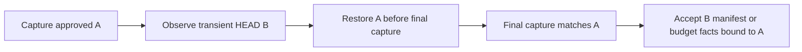

# D5c audit — FAIL

**Dispatch:** `hma-gate-d-audit-20261029-d5c20p`  
**Date:** 2026-10-29  
**Target:** `main` at `e65ce7272be758dafa4db523582e144332ad1e29`  
**Scope:** the complete 26-file diff from `3cacb4c8ab1fae2cb39fae8eadfdc073392baeb9`. D6 is outside this audit.

## Human review layer

Observed: the requested regression commands pass. Independent controls reproduce two high defects. Both defects can suppress an actual line-budget finding. Two medium findings concern the staged flag and platform documentation. The source repository stayed clean and unchanged. No repair was made.

Current state: D5c acceptance is not supported. This audit does not issue a stage transition. Machine verdict: **FAIL**. The exact approval challenge was not supplied. No active waiver record was supplied for this audit. A waiver cannot remove the two reproduced target-binding kernel defects.

Isolation is **partial**. This is a fresh-context code review. The assigned route is prof / OpenAI / gpt-6.1-sol / high, in review mode. Runtime model telemetry was not independently available. Provider and model-family separation exists from the Claude Sonnet 5.5 orchestrator and the Copilot-enterprise implementer that reports Claude Sonnet 5.5. OpenAI is shared with Jax and Liz. Separation from every implementer is therefore not met. This report is **not eligible for final independent acceptance**. The code evidence determines FAIL; the provider caveat does not change that verdict.

| Finding | Severity | Observed result | Disposition |
|---|---|---|---|
| D5C20P-F01 | High | Global case folding hides a 150-line untracked file from capture, packet and budget import. | BLOCK |
| D5C20P-F02 | High | A temporary HEAD change substitutes another revision in a clean manifest or budget measurement. | BLOCK |
| D5C20P-F03 | Medium | An index reset and restore produces an incorrect `staged=false` flag. | ADVISORY |
| D5C20P-F04 | Medium | The handoff understates the non-Linux packet restriction. | ADVISORY |

BLOCK above is the reviewer disposition for the reproduced architecture §7.1 invariant failures. It does not create a new HMA kernel registry entry or grant machine authority. This manual-dispatch report has no supplied HMA packet nonce/binding. Severity alone does not select disposition.

## Frozen inputs and independence

The initial freeze matched the supplied commit and clean tree. The final freeze matched the initial freeze. Both are retained in [FREEZE_START.json](FREEZE_START.json) and [FREEZE_END.json](FREEZE_END.json).

- Unit binary diff SHA-256: `d9964c7cf2d11df52a310ad5a4c9b1bf1fd84124a8617b9c45709169fbcae454`. Raw diff: [unit.diff](unit.diff).
- `git diff --binary HEAD` SHA-256: `e3b0c44298fc1c149afbf4c8996fb92427ae41e4649b934ca495991b7852b855`.
- `git status --short`: empty. Untracked-file list: empty. Branch: `main`.
- `git diff 3cacb4c HEAD -- internal/repostate/raw.go`: empty. Its SHA-256 is the empty-string digest.
- `raw.go` byte SHA-256 at both D5b and the target: `03a02c9adffab8f04a0fd9f1d4016c62a787f9b28395b0fe7fa9b354e5a702cc`.
- Phase 1 SHA-256: `3dc7f666799ce2a3c2b704e9789001e5911a795972adf01ff241a87f7c268ab2`. See [PHASE1.json](PHASE1.json) and [PHASE1.sha256](PHASE1.sha256).

Phase 1 was frozen at `2026-10-29T13:16:49.769388+00:00`. It contains independently derived requirements, two high findings and execution evidence. I had not opened the D5c handoff or any file under `docs/handoffs/evidence/gate-d/`. I then read all three changed documents. Phase 1 was not rewritten. The evidence directory was never opened for review. The complete per-file assessment is [REVIEW_COVERAGE.json](REVIEW_COVERAGE.json).

Authority decisions from Lennon on 2026-10-22 are accepted: `contract.intent` is the immutable request; the diff is a capped changed-file manifest; runs with no bound contract retain the legacy packet content. None is re-litigated as a finding. The concurrent-writer threat model includes repository file/ref changes. It does not require a hostile OS or modification of the host evidence store.

Source comments and tests contain descriptions of earlier findings. I treated them as audited artifacts. I did not read prior audit reports or implementer chat. The supplied scope pointers also limit perfect blinding. No subagent, nested agent CLI or model API was used. No approved Jev tool was available. Direct auditor judgment selected the next action.

## Requirements and coverage

| ID | Requirement | Result | Evidence |
|---|---|---|---|

| R01 | Contract intent is the immutable request. Carry approved criterion definitions, non-goals, the full approved plan unit and budgets, base/head and changed-file manifest, evidence references, active waiver terms and policy. Source: docs/architecture.md §16; human decision 2026-10-22. | **PASS** | cmd/hma/packetstate.go; cmd/hma/review.go |

| R02 | The manifest, digest and budget measurement describe one captured target. Concurrent changes must not substitute other bytes or another revision. Source: docs/architecture.md §14, §16; Gate C scope §4a. | **FAIL** | TestAudit20CleanCaptureHeadBinding; TestAudit20CleanPacketHeadSwapRestore |

| R03 | Ignore evaluation uses captured bytes and preserves deterministic raw snapshot semantics; local/global exclusion mechanisms cannot conceal otherwise included paths. Source: docs/architecture.md §14; Gate C scope §4a; Gate B raw snapshot contract. | **FAIL** | TestAudit20IgnoreCaseParity; TestAudit20IgnoreCasePacketAndFindings |

| R04 | Repeated reads of a tracked file or ignore file with disagreeing content fail capture; anchored reads cannot follow swapped parent symlinks. Source: docs/architecture.md §14; trusted-host concurrent-writer threat model. | **PASS** | TestAudit20IgnoreCapturedBytes; TestAudit20IndependentPathChecks; existing anchored-reader tests |

| R05 | Budget facts are computed by HMA from the packet target. Severity does not create disposition. Source: docs/architecture.md §16; Gate A v3 §4.1; Gate C scope §3. | **FAIL** | TestAudit20IgnoreCasePacketAndFindings; TestAudit20CleanCaptureHeadBinding |

| R06 | No-bound-contract packets retain the legacy packet content and fields. Source: human decisions 2026-10-22; docs/architecture.md §16. | **PASS** | TestAuditNoContractPacketKeys; static legacy conditional branches |

| R07 | Bound packet caps refuse explicitly. Truncated line counts stay qualified; line budget is exceeded on byte truncation. Source: docs/architecture.md §14, §16; approved size-cap interpretation. | **PASS** | existing packet/line-window negative controls; cmd/hma/disposition.go:146 |

| R08 | internal/repostate/raw.go remains byte-identical since 3cacb4c. Source: user audit instructions; Gate B invariant. | **PASS** | FREEZE_START.json raw_diff_sha256 |

| R09 | Use go1.27.3 in isolated copy and run go vet, full suite, and specified race suite. Report skips and bubblewrap. Source: user regression contract. | **PASS** | REGRESSION.json; logs/test.log; logs/race.log |

| R10 | Disclose provider and family relationships and separate-context limits; do not claim final-acceptance eligibility. Source: docs/architecture.md §13; Gate C scope §4a; user disclosure instruction. | **PASS** | Fresh-context review; partial provider independence disclosed; eligibility is not satisfied |

| R11 | Compare changed documentation claims to code after freezing blind code assessment. Source: docs/architecture.md §19; user whole-diff scope. | **FAIL** | docs/handoffs/2026-10-22-gate-d-d5c.md:111; logs/followup.log; logs/followup-race.log |

| R12 | Per-path staged flags describe the same index captured by the bound target digest. Source: docs/architecture.md §16; changed_files staged contract in cmd/hma/review.go and D5c handoff. | **FAIL** | cmd/hma/observe.go:130; logs/index.log; logs/index-race.log |

R10 evaluates honest disclosure. It does not mark the required final provider separation as satisfied. The final-acceptance eligibility flag is false. R11 and R12 were completed after the immutable Phase 1 report. The other conclusions remain unchanged.

## Execution evidence

Environment: `go version go1.27.3 linux/amd64`, `git version 2.34.1`, `bubblewrap 0.6.1`. The Go binary is `/home/yeli/.local/go/bin/go`. The stale `/usr/local/go` toolchain was not used. The working copy is `/tmp/hma-gate-d-20261029-d5c20p/repo`. `GOCACHE=/tmp/hma-gate-d-20261029-d5c20p/gocache`, `TMPDIR=/tmp/hma-gate-d-20261029-d5c20p/tmp`, `GOTOOLCHAIN=local`. Exact versions and environment are in [ENVIRONMENT.json](ENVIRONMENT.json).

| Check | Result | Complete log |
|---|---|---|
| `go vet ./...` | Exit 0 | [vet.log](logs/vet.log) |
| `go test -count=1 -v ./...` | Exit 0; 1,171 passed test/subtest result lines; two skips | [test.log](logs/test.log) |
| `go test -count=1 -race -v ./cmd/hma ./internal/evidence ./internal/repostate ./internal/host ./internal/engine` | Exit 0; 953 passed test/subtest result lines; two skips; no data-race reports | [race.log](logs/race.log) |
| Phase 1 independent controls | Exit 1, with and without `-race`; four failing test functions reproduce F01/F02 | [probes-final.log](logs/probes-final.log), [race log](logs/probes-final-race.log) |
| Full clean findings-import and platform controls | Exit 1, with and without `-race`; F02 import failure reproduced; clean-platform assertion passes | [followup.log](logs/followup.log), [race log](logs/followup-race.log) |
| Index reset/restore control | Exit 1, with and without `-race`; F03 reproduced | [index.log](logs/index.log), [race log](logs/index-race.log) |
| Requested three regression files, twice, shuffled seed 20261029 | Exit 0; 44 passed test/subtest result lines | [focused-shuffled.log](logs/focused-shuffled.log) |

The regression runs used the unchanged committed source before the independent probes were installed. The prepared copy now contains three added `audit20*test.go` files. A full test run there now includes the intentionally failing independent controls. The original regression logs remain separate.

Only these tests skipped in the full and specified race suites:

- `internal/host.TestGateBR2HostChild`: child-only entry point. The parent `TestGateBR2HostSeparateProcessWriters` passed and exercised its child path.
- `internal/host.TestGateBR2HostPowerLossImage`: explicitly skipped as an unreachable legacy crash image after the directory-sync fix. The skipped body was not executed.

Bubblewrap **started**. `TestSandboxShowsOnlyTheCopy` passed in both suites. Credit confinement checks also passed. This is separate from the outer command launcher: its default sandbox failed with `bwrap: execvp codex-linux-sandbox: No such file or directory`. The reviewed `require_escalated` fallback ran the commands. The test harness itself was not fully OS-confined. Tests ran on the copy. HMA sandboxed commands ran through bubblewrap.

Full command vectors, timestamps and exit codes are in [REGRESSION.json](REGRESSION.json), [PROBES_FINAL.json](PROBES_FINAL.json), [FOLLOWUP.json](FOLLOWUP.json), [FOLLOWUP_RACE.json](FOLLOWUP_RACE.json), [INDEX.json](INDEX.json) and [FOCUSED.json](FOCUSED.json). [TEST_SUMMARY.json](TEST_SUMMARY.json) records result counts, skips and failures. Files retain complete output. Tool-display truncation did not truncate these log files. No regression failure is assumed pre-existing: the original regressions passed. The defective observation and ignore functions are newly introduced in the saved D5c diff.

## Findings and proposed repairs

### D5C20P-F01 — Scratch ignore evaluation inherits case folding and conceals an in-scope file

**Severity:** high. **Certainty:** observed. **Disposition:** BLOCK. **Closure:** blocking. **Fix:** proposed, unvalidated.

**Source:** [internal/repostate/paths.go:307](/home/yeli/repos/HMA/internal/repostate/paths.go:307). 

**Requirement:** Architecture §7.1: correct repository/revision identity and authentic, current, revision-bound evidence. Architecture §14 and §16: describe the captured target and its actual scope.

**Observed failure and diagnosis:** The main snapshot forces core.ignoreCase=false. The new scratch check-ignore process supplies only core.excludesFile=/dev/null and inherits global/environment Git configuration. Under inherited core.ignoreCase=true, a committed SECRET rule ignores the distinct Linux path secret. The unchanged Gate B Snapshot includes secret, but CaptureTarget reports a clean worktree. The manifest and budget measurement omit its 150 lines. Full review-packet, review-import and findings-import succeed and record no budget finding. The writer needs no control over the global configuration; the failing condition is an already configured trusted host.

**Impact:** A fixed review packet can present an incomplete target and suppress an automatically established WAIVABLE line-budget finding. This is a reproduced binding failure, not a finding derived from severity.

**Reproduction:**

1. Use the isolated audit copy and the preserved probes/audit20_test.go.
2. Commit .gitignore containing SECRET. Add an untracked lowercase secret containing 150 lines. Set GIT_CONFIG_GLOBAL to an output-directory fixture containing [core] ignoreCase=true.
3. Run go test -count=1 -v -run "^TestAudit20IgnoreCase(Parity|PacketAndFindings)$" ./cmd/hma using ENVIRONMENT.json.
4. The assertions fail. The end-to-end case uses a synthetic approved contract/plan and receipt fixture with max_diff_lines=100. It invokes real command entry points; it does not contact a model.

**Evidence:**

- internal/repostate/paths.go:307: check-ignore omits the core.ignoreCase=false override present in internal/repostate/snapshot.go:137.
- logs/probes-final.log; logs/probes-final-race.log: TestAudit20IgnoreCaseParity: legacy worktree digest nonempty; captured worktree empty; changed=[]; manifest=[]; measurement=(0,0). TestAudit20IgnoreCasePacketAndFindings: packet_worktree="", secret_in_manifest=false, findings_import_err=nil, findings=map[].
- cases/ignorecase-packet.md; cases/ignorecase-findings.json: Retained accepted packet omits secret and binds an empty worktree digest. Imported findings are empty.

**Preferred repair:** Give scratch check-ignore the same deterministic observation configuration as the snapshot, including core.ignoreCase=false. Explicitly pin its private git directory/worktree so inherited worktree-selection configuration cannot redirect evaluation. Preserve the exclusion of core.excludesFile and info/exclude. Add the end-to-end inherited-configuration regression.

**Why:** Captured ignore bytes alone do not fix the meaning of those rules when the Git evaluator uses different configuration.

**Independent exit checks:**

- Re-run the two independent case-folding tests with and without -race. Expected: secret appears in capture and manifest; max_diff_lines is exceeded; clean capture is refused.
- Re-run the nested-ignore/negation/directory/self-ignore/exclusion matrix. Expected: Unchanged rules produce the same target as the Gate B snapshot; global and info exclusions cannot conceal files.

**Trade-offs:** Use the smallest Git-process change. Preserve explicitly required safe.directory handling. A larger Git configuration cleanup needs separate justification.

**Alternative:** Containment: require and verify effective scratch core.ignoreCase=false at the host. This narrows supported configurations and does not replace the durable code fix.

**Effort and priority:** small. Repair before D5c can advance.

### D5C20P-F02 — Clean observations can use a transient HEAD outside the supplied capture

**Severity:** high. **Certainty:** observed. **Disposition:** BLOCK. **Closure:** blocking. **Fix:** proposed, unvalidated.

**Source:** [cmd/hma/observe.go:117](/home/yeli/repos/HMA/cmd/hma/observe.go:117). Related: [cmd/hma/observe.go:159](/home/yeli/repos/HMA/cmd/hma/observe.go:159), [cmd/hma/review.go:403](/home/yeli/repos/HMA/cmd/hma/review.go:403), [cmd/hma/review.go:412](/home/yeli/repos/HMA/cmd/hma/review.go:412), [cmd/hma/disposition.go:106](/home/yeli/repos/HMA/cmd/hma/disposition.go:106).

**Requirement:** Architecture §7.1: correct revision identity and current, revision-bound evidence. Architecture §16 and Gate C scope §4a: a review describes the exact bound artifact.

**Observed failure and diagnosis:** observeCaptured resolves live HEAD and loads its tree even when a capture is supplied. Its capture.State.Head comparison runs only inside if dirty. For dirty=false, an A-to-B-to-A HEAD change produces an accepted packet bound to A whose manifest hashes B. The final capture sees A and accepts it. The same function measures finding budgets. A second end-to-end control shows an approved 150-line committed target receiving an empty findings snapshot when measurement temporarily observes a smaller commit.

**Impact:** A reviewer can receive a manifest for another committed revision. HMA can also omit an actual line-budget finding while both surrounding target captures match. The schedule requires a writer able to move a repository ref. It does not change HMA host records or Git command results.

**Reproduction:**

1. Run go test -count=1 -v -run "^TestAudit20Clean(CaptureHeadBinding|PacketHeadSwapRestore)$" ./cmd/hma in the prepared copy.
2. The packet test captures clean commit A. The before-manifest hook changes only HEAD to an existing commit B. A deterministic Git wrapper calls /usr/bin/git for all results and restores HEAD to A after the target blob read, before the second capture.
3. Run go test -count=1 -v -run "^TestAudit20FollowupCleanFindingsSwapRestore$" ./cmd/hma. Its stable and scheduled subtests each own a fresh fixture.
4. The import test captures the 150-line approved committed target, moves HEAD only during measurement, and restores it before the final check. It fails because the budget finding disappears.

**Evidence:**

- cmd/hma/observe.go:117; cmd/hma/observe.go:146; cmd/hma/observe.go:159: Live head is read unconditionally. Equality with supplied capture head is checked only in the dirty branch.
- logs/probes-final.log; logs/probes-final-race.log: TestAudit20CleanCaptureHeadBinding accepts a different head for both manifest and measurement. TestAudit20CleanPacketHeadSwapRestore accepts bound head A with the SHA-256 of B content; captureLiveTarget accepts restored A.
- logs/followup.log; logs/followup-race.log: TestAudit20FollowupCleanFindingsSwapRestore: stable control records U1/HMA-BUDGET-max_diff_lines-<artifact>:WAIVABLE. Scheduled case imports successfully with findings=map[]. Both cases restore the original captured State.
- cases/head-swap-packet.md: Retained accepted packet binds the approved head and contains the manifest hash of the other commit.

**Preferred repair:** Use capture.State.Head as the immutable head for all supplied captures, clean and dirty. Check a live-head mismatch before tree/blob reads for either mode, and build the committed side from the captured head. Retain the final live-target check. Add deterministic clean A-to-B-to-A packet and findings-import controls.

**Why:** Two surrounding snapshots cannot authenticate the bytes or revision read between them. The actual observation must use the same captured revision.

**Independent exit checks:**

- Run direct manifest/measurement and full packet controls under the A-to-B-to-A schedule. Expected: Refuse with HOST_REVIEW_TARGET_CHANGED or produce only the captured A manifest; never accept a B manifest bound to A.
- Run stable and scheduled committed-budget import controls, with and without -race. Expected: The 150-line excess remains WAIVABLE, or the changed target is refused; no empty successful snapshot.
- Keep existing dirty byte-identity and unsupported-platform controls green. Expected: No unsafe legacy read fallback is restored.

**Trade-offs:** Pinning immutable object IDs is small and fits the current capture API. Do not treat another before/after snapshot as sufficient containment.

**Alternative:** Build the entire manifest from a private materialized copy of the captured commit. This gives stronger isolation but has greater I/O and integration cost.

**Effort and priority:** small. Repair before D5c can advance.

The A-to-B-to-A schedule explains why the final comparison is insufficient. This diagram is a presentation aid. The executable tests and logs are the evidence.

### D5C20P-F03 — Manifest staged flags are taken from a different index read

**Severity:** medium. **Certainty:** observed. **Disposition:** ADVISORY. **Closure:** non-blocking. **Fix:** proposed, unvalidated.

**Source:** [cmd/hma/observe.go:130](/home/yeli/repos/HMA/cmd/hma/observe.go:130). Related: [cmd/hma/observe.go:242](/home/yeli/repos/HMA/cmd/hma/observe.go:242), [internal/repostate/snapshot.go:356](/home/yeli/repos/HMA/internal/repostate/snapshot.go:356), [internal/repostate/snapshot.go:371](/home/yeli/repos/HMA/internal/repostate/snapshot.go:371).

**Requirement:** Architecture §16: fixed packet inputs. The implemented changed_files.staged field must describe the target whose worktree digest includes the index.

**Observed failure and diagnosis:** Capture hashes the index entries into the dirty-worktree identity, but does not return that captured index to observation. observeCaptured re-reads ls-files and computes staged from that later index. Resetting a path index entry after capture and restoring it after the observation index read produces an accepted staged=false flag even though both surrounding captures have Staged=true and exactly the same worktree digest.

**Impact:** The packet misstates staged status. No independent criterion-credit or budget bypass was demonstrated for this metadata-only case. The two high findings independently require FAIL.

**Reproduction:**

1. Run go test -count=1 -v -run "^TestAudit20IndexMetadataSwapRestore$" ./cmd/hma in the prepared copy.
2. Stage content for a different a blob, then restore the original on-disk bytes. Capture this dirty target.
3. After capture, reset only the index entry to HEAD. Once observation has read that index, restore the captured index entry before the second capture.
4. The packet succeeds and its a entry reports staged=false.

**Evidence:**

- cmd/hma/observe.go:130; internal/repostate/snapshot.go:356: Observation and capture read the index separately. Captured Entries identifies worktree entries, not the per-path index state.
- logs/index.log; logs/index-race.log: TestAudit20IndexMetadataSwapRestore: stable manifest Staged=true; accepted manifest Staged=false; before.State==after.State, both State.Staged=true, restored=true.

**Preferred repair:** Return the relevant per-path index entries from the existing capture index read. Derive supplied-capture manifest staged flags from those entries. Do not resolve the flag from a later live index.

**Why:** The current capture binds index bytes but observation has no immutable copy of that metadata.

**Independent exit checks:**

- Run the deterministic index reset/restore control with and without -race. Expected: Either refuse a mismatched index observation or preserve staged=true from the captured index.
- Run staged-only, staged-delete, staged-rename and dirty-content regressions. Expected: Per-path staged flags and artifact identities remain correct.

**Trade-offs:** Retaining an index map costs memory proportional to relevant index entries. It avoids another Git process and preserves Gate B raw.go.

**Alternative:** Compare the observation index read against a recorded captured index fingerprint and refuse mismatches. This still requires capturing and retaining the fingerprint.

**Effort and priority:** small. Include with the bounded correction. This finding does not independently establish a budget or criterion-credit bypass.

### D5C20P-F04 — The handoff understates the non-Linux review-packet restriction

**Severity:** medium. **Certainty:** observed. **Disposition:** ADVISORY. **Closure:** non-blocking. **Fix:** proposed, unvalidated.

**Source:** [docs/handoffs/2026-10-22-gate-d-d5c.md:111](/home/yeli/repos/HMA/docs/handoffs/2026-10-22-gate-d-d5c.md:111). Related: [cmd/hma/observe.go:74](/home/yeli/repos/HMA/cmd/hma/observe.go:74), [cmd/hma/observe_other.go:14](/home/yeli/repos/HMA/cmd/hma/observe_other.go:14), [cmd/hma/review.go:348](/home/yeli/repos/HMA/cmd/hma/review.go:348).

**Requirement:** Architecture §19: state limitations and do not convert missing capability into confidence.

**Observed failure and diagnosis:** The handoff says committed targets work everywhere and limits the platform loss to dirty-approved contract-bound packets. captureTarget now returns the unsupported-reader error unconditionally before checking dirty. All review-packet commands use it before checking whether a contract is bound. Clean review-packet and live-target commands therefore also refuse on non-Linux builds. A clean Linux fixture with the non-Linux sentinel reproduces the unconditional refusal; native non-Linux execution was not performed.

**Impact:** The handoff gives operators the wrong support boundary. This is a documentation defect. It does not justify restoring unanchored worktree reads.

**Reproduction:**

1. Inspect the unconditional captureTarget platform guard and the !linux unsupported-reader assignment.
2. Run go test -count=1 -v -run "^TestAudit20FollowupCleanUnsupported$" ./cmd/hma in the prepared Linux copy.
3. The fixture is clean, but packet generation returns the platform sentinel. Native non-Linux behavior is inferred from the build-tagged assignment.

**Evidence:**

- docs/handoffs/2026-10-22-gate-d-d5c.md:111: The document says committed targets work everywhere and describes only a dirty-approved contract-bound loss.
- cmd/hma/observe.go:74; cmd/hma/observe_other.go:16; cmd/hma/review.go:348: The platform guard applies to all captureTarget calls, including clean and legacy packet paths.
- logs/followup.log; logs/followup-race.log: TestAudit20FollowupCleanUnsupported passes: clean_target=true, dirty_approved=false, error=independent clean-platform sentinel.

**Preferred repair:** Update the handoff to distinguish direct committed-object observation from commands that first capture the live worktree. State that review-packet generation and live-target import checks currently require the Linux anchored reader even for clean targets, including no-contract runs. Keep the 16 MiB limitation text qualified.

**Why:** The present platform loss is broader than the stated dirty-only limitation.

**Independent exit checks:**

- Compare the revised platform-support statement to every captureTarget entry point. Expected: The document states the actual clean/dirty and bound/unbound command behavior.
- Retain the clean/dirty unsupported-platform sentinel tests. Expected: Commands refuse before reading worktree bytes; no legacy fallback is introduced.

**Trade-offs:** Documentation repair only. Restoring cross-platform safe capture is separate implementation work.

**Alternative:** If clean cross-platform packets are a new requirement, implement an equally anchored reader for those platforms under a separately approved scope.

**Effort and priority:** small. Include with the bounded correction. This finding does not independently establish a budget or criterion-credit bypass.

## Direct answers about the capture and tests

**Ignore files:** with ordinary deterministic configuration, the scratch evaluator uses the captured bytes. I changed the real `.gitignore` after the reader returned its second captured value. Capture still included the untracked file. I separately returned conflicting content on that second read. Capture refused it. The six-case parity matrix passed for nested rules, negation, excluded-parent behavior, re-included children, directory-only rules, globstar and a self-ignoring untracked `.gitignore`. Files hidden only by `core.excludesFile` or `.git/info/exclude` remained included. These results do not close F01: the evaluator inherits different case semantics from the main snapshot.

**Repeated reads:** changed tracked paths and tracked ignore files compare the `WorktreeEntry.Record` identity before a second value is accepted. The direct conflicting-reader control fails closed. Tracked/untracked/symlink observation and measurement checks pass in independent fixtures. This is bounded evidence for these tested entry kinds. It is not an atomic snapshot guarantee over every possible concurrent filesystem change.

**Legacy calls:** No review-packet, review-import or findings-import path still calls legacy Snapshot/ChangedPaths for its target worktree capture. captureTarget uses CaptureTarget unconditionally and refuses before worktree reads when the anchored reader is unavailable. Dirty observeCaptured without a supplied capture uses CapturePaths with anchoredReader. Broader repository code still calls legacy Snapshot in transition/apply, CLI transition, CI, pilot, loop evidence and credit. LaunchDigests still asks Git to compute receipt digests. Those are pre-existing separate paths; this report does not assert that all HMA worktree reads are anchored.

**Budget/live-target binding:** findings import passes the captured live target into measurement and checks the live target again afterward. That closes the tested dirty-byte substitution. It does not pin a clean observation to the captured HEAD, and it does not return the captured per-path index metadata. F02 and F03 are the remaining reproduced gaps. F01 can also remove a file before this binding is formed.

**Test quality:**

- `d5c16p_capture_test.go` restores `f` before mutating `u`. Its second assertion is no longer masked by the first mutation. The focused shuffled run and separate fixtures support that conclusion.
- `TestIndependentPacketSwapRestore` now rejects at `checkObserved` before the restore hook is reached. `TestIndependentFindingsBudgetSwapRestore` now mutates during the initial `captureLiveTarget` scan and is rejected by the repeated-read check before `findingFacts` measures. These test outcomes verify earlier rejection. They do not themselves execute a completed measurement-and-restore schedule. Some mutation branches accept any error; the saved logs identify the observed refusal as `HOST_REVIEW_TARGET_CHANGED`.
- `d5c18l_regression_test.go` creates separate tracked, untracked and symlink fixtures. Its repeated-read test actively changes the second returned tracked read. Its unsupported-false test checks for no reads but does not require a nonnil error. The new clean-platform control requires the sentinel error.
- The Audit18 ignore scheduler triggers only on `--exclude-per-directory=.gitignore`. Current production discovery no longer passes that argument. Those tests remain a regression tripwire for the old path; they are not active mutation tests of the new scratch evaluator. The independent captured-reader controls cover that evaluator.
- `TestIndependentDirtyDiscoveryReadsOutsideParent` did not observe an outside read within its eight-second runs. As its log says, that is no safety conclusion. `TestWorktreeParentSwapCannotRedirectLookup` provides a deterministic retained-parent test.
- The requested tests pass twice with shuffled order. No ordering dependency was reproduced. They do not cover inherited case folding, clean HEAD substitution or captured-index flag substitution. The new controls do.

## Documentation comparison and controlled unblinding

The D5c handoff was read only after Phase 1 and its digest were saved. It did not overturn either high finding. The accepted request/manifest/legacy decisions remain accepted. The handoff now correctly states that capture can hold full files in memory before the streamed 16 MiB counting window. I do not report the earlier whole-capture memory overclaim as still present.

F04 records the remaining platform overclaim. The broad statements that the two views cannot disagree and any intermediate target change is refused are also too strong under F01/F02/F03. Correct those statements with the implementation repairs. The two architecture-amendment documents are explicitly drafts/provenance. Their existence is not evidence that other gates are implemented. I do not expand D5c into a re-audit of D6, lease design or the accepted authority decisions.

After Phase 1, I added the full findings-import reproduction for F02, the captured-index reproduction for F03 and the clean-platform control for F04. The original Phase 1 file remains unchanged. See [UNBLINDING.json](UNBLINDING.json).

## Repair acceptance and limits

The bounded correction should retain the independent controls in [probes/audit20_test.go](probes/audit20_test.go), [probes/audit20_followup_test.go](probes/audit20_followup_test.go) and [probes/audit20_index_test.go](probes/audit20_index_test.go). The code fixes are proposals. I did not implement them. The exit criteria are: no omitted case-distinct file; no manifest or budget facts from another HEAD; staged metadata matches the captured index; truthful platform documentation; the requested regressions pass; `raw.go` remains byte-identical; and the corrected target receives an eligible independent review.

No optional redesign or unrelated cleanup is proposed. The two medium findings have evidenced non-blocking dispositions for this audit: the staged flag control demonstrates annotation drift without a budget/credit bypass, and the platform guard fails closed. The two high findings remain open and blocking.

Audit limits:

- Provider independence is partial. OpenAI is shared with implementers Jax and Liz. This report does not satisfy the final-audit requirement of provider/model-family separation from every implementer. The FAIL verdict is based on code evidence, not that caveat.
- The auditor route prof / OpenAI / gpt-6.1-sol / high is supplied by the dispatch. Runtime model telemetry was not independently available.
- Initial context includes user-supplied scope pointers and authority decisions. Source test comments describe earlier findings. No earlier audit report or implementer chat was read before freezing Phase 1. The D5c handoff was read only afterward. Files under docs/handoffs/evidence/gate-d/ were not opened for review.
- The outer exec sandbox launcher failed before execution. The approved require_escalated fallback ran the audit. Tests ran on an output-directory repository copy, with GOCACHE and TMPDIR there. This is process/workspace isolation, not a claim of full OS confinement of the test harness. HMA bubblewrap execution itself passed.
- No native macOS or Windows execution was performed. The unsupported-platform path was inspected statically and simulated with the same package guard.
- The eight-second directory-swap regression did not observe an outside read. Its passing result is not a proof of race absence. The separate deterministic retained-parent test provides the stronger bounded evidence.
- The existing Audit18 Git scheduler targets the removed --exclude-per-directory=.gitignore argument. It does not actively mutate the current scratch check-ignore invocation. Independent reader controls cover copied ignore bytes and contradictory repeated reads.
- No production fixes were made or validated. Proposed remedies need implementation and independent verification. The audit did not execute a real model dispatch, publish, commit, push or alter the source repository.
- This report has no supplied HMA packet nonce/binding. It is a scoped manual-dispatch audit artifact, not an imported final approval.

The JSON report uses the human-requested verdict `FAIL`. [AUDIT.skill.json](AUDIT.skill.json) changes only that enum to the skill value `fix-required`. The skill validator ran on this projection and returned VALID for form only. See [report-validation.log](logs/report-validation.log). This does not validate the truth of findings, the proposed fixes or auditor independence. [AUDIT.json](AUDIT.json) retains the requested verdict. [MANIFEST.sha256](MANIFEST.sha256) records evidence hashes.

## Single next action — architecture §18

**RETURN_D5C_FOR_BOUNDED_REWORK**. Return D5c to the orchestrator with this report. Repair F01 and F02, include F03/F04 in the bounded correction, and retain the independent controls as acceptance checks.

**Rationale:** Two reproduced high-severity failures break target binding and suppress budget findings despite green regressions.

**Owner:** HMA implementer/orchestrator (Claude Sonnet 5.5), who must select an eligible bounded worker route.

**Proposed route:** Use the existing human-approved D5c implementation route after exact-route hi preflight. Its current worker/provider/model/effort/access telemetry was not supplied to this auditor; do not infer or silently substitute it.

**Permission envelope:** For the implementation owner: bounded repository edits and tests inside valid D5c authority; no commit, push, release or external messages are authorized by this audit. Auditor remains read/execute/test with report writes under the output directory only.

**Exact approval:** This audit grants no transition or write approval. If the current unit lacks an active implementation lease, the human must approve the challenge-bound rewind/route transition to IMPLEMENTATION_AUTHORIZATION before repair. Under an active same-route lease, follow its already approved limits.

**Stop/escalation conditions:** Do not advance D5c while F01/F02 remain reproducible. Stop if authority, exact route, permission envelope or Gate B raw.go byte identity cannot be verified. A final acceptance review still needs an independent route with provider/model-family separation from every implementer. No eligible route may be assumed from this partial-isolation report.
